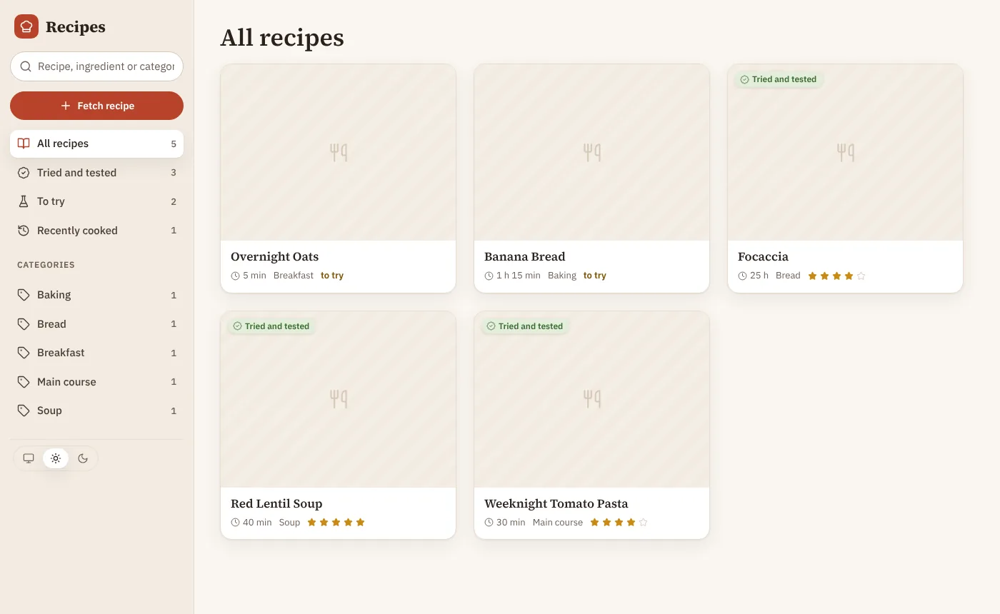
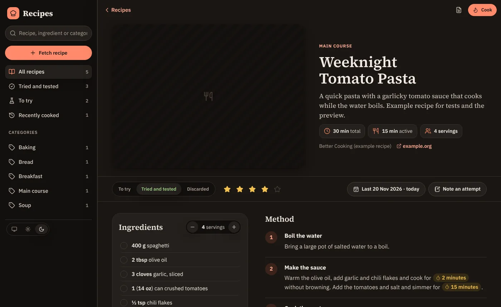
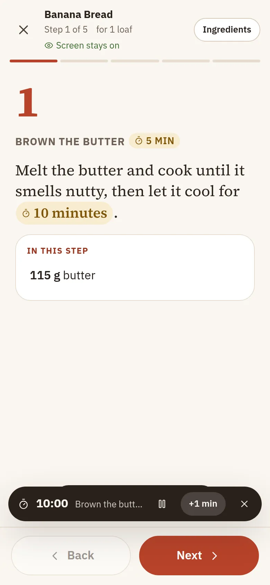

# Better Cooking

Browse, search and cook your recipe notes in [Obsidian](https://obsidian.md): a card overview, instant search, a recipe page with a servings calculator, a step-by-step cooking mode with timers, and import from a link.

> **Status: beta (0.x).** Better Cooking grew out of a private vault and is being prepared for the Obsidian Community Directory ([Roadmap](docs/roadmap.md)). The recipe folder is configurable, the note format is documented in [docs/recipe-format.md](docs/recipe-format.md), and the interface is available in English and German, following Obsidian's language.

<p>
  
</p>
<p>
  
  
</p>

## Features

- **Overview:** recipe cards with photo, time, category, status and rating; lists for tried and tested, to try, recently cooked, by category.
- **Search:** instant, offline full-text search with prefix matching, typo tolerance, German normalization (ä = ae) and compound words (`mehl` finds `Dinkelmehl`).
- **Recipe page:** servings calculator with sensible rounding, checkable ingredients, timeline graphic, numbered steps where every duration is a timer button, tips, attempts log, photos.
- **Cooking mode:** one step per screen in large type, ingredients used in that step, screen stays on, multiple timers.
- **Shopping list:** add a recipe's ingredients for the servings you need; equal items are merged (500 g + 1 kg flour = 1,5 kg) into a plain Markdown checklist that works without the plugin.
- **Track your cooking:** status, star rating, "made today" and an attempts log, written to the note's frontmatter.
- **Import:** paste a link to a recipe website and Better Cooking reads its recipe data itself (schema.org, no AI). Pasted text is split up by simple rules without AI, or goes, like pages without recipe data, to your own AI (Anthropic or any OpenAI-compatible server, also a local model), social media to a processor you set up yourself. Duplicate sources are detected before anything is sent.
- Light and dark "kitchen" palette, adjustable with the [Style Settings](https://github.com/mgmeyers/obsidian-style-settings) plugin, or the colors and fonts of your Obsidian theme (setting "Colors"). Works on desktop and mobile.

## Installation

Not yet in the Community Directory. Beta testers install it with BRAT and get updates automatically: [docs/beta-testing.md](docs/beta-testing.md). Or install a release manually:

1. Download `main.js`, `manifest.json` and `styles.css` from the [latest release](https://github.com/JakobBolenbach/better-cooking/releases).
2. Copy them to `<your vault>/.obsidian/plugins/better-cooking/`.
3. Reload Obsidian and enable **Better Cooking** under Settings → Community plugins.

Requires Obsidian 1.11.4 or later.

## Recipe notes

Better Cooking reads Markdown notes with a fixed structure (frontmatter plus sections such as `## Ingredients` and `## Steps`). The recipe folder is configurable; notes can be written with English or German field names and headings, single fields can be mapped to your own names, and both languages are always read. The format is described in [docs/recipe-format.md](docs/recipe-format.md).

## Network use, accounts and privacy

Better Cooking works fully offline. It only uses the network when **you** start an import, and only with services **you** configure:

- **Recipe website:** loads the page you pasted and its cover image (only from public addresses).
- **Own AI:** sends pasted text or the text of a page without recipe data to the AI you configured (Anthropic API, or an OpenAI-compatible address such as a local Ollama). The AI only extracts the recipe; Better Cooking checks the answer and writes the note itself.
- **Claude (Anthropic):** sends the link or text to your own scheduled task through Anthropic's API. Needs your own Anthropic account and token.
- **GitHub:** starts a workflow in your own repository through the GitHub API. Needs your own GitHub token.

Keys and tokens are stored in Obsidian's secret storage (the device keychain), never in the vault or in `data.json`. There is no telemetry and no tracking. Details of what a processor receives and must return: [docs/import-contract.md](docs/import-contract.md).

## License

Better Cooking is **source-available** under the [PolyForm Noncommercial License 1.0.0](LICENSE).

- You may use, copy, modify and share it for any **noncommercial** purpose: personal use, hobby projects, research, education, charities and similar.
- **Commercial use** (selling it, bundling it with a paid product or service, using it in a business) needs a separate license. Ask via [GitHub](https://github.com/JakobBolenbach).

Because it restricts commercial use, this is not an "open source" license in the sense of the [Open Source Definition](https://opensource.org/osd). The reasoning is recorded in [ADR 0001](docs/adr/0001-license.md). Third-party components and their licenses: [THIRD_PARTY_NOTICES.md](THIRD_PARTY_NOTICES.md).

## Contributing

Bug reports and ideas are welcome as [issues](https://github.com/JakobBolenbach/better-cooking/issues). Code contributions need a contributor license agreement first, see [CONTRIBUTING.md](CONTRIBUTING.md). Security issues: [SECURITY.md](SECURITY.md).

## Development

Requires Node.js 22 and pnpm 10.

```sh
pnpm install
pnpm check      # format, lint (Obsidian's rules), typecheck, tests
pnpm build      # styles.css + main.js
pnpm preview    # then open dev/preview.html in a browser, no Obsidian needed
pnpm dev        # watch build; in Obsidian, this build reloads itself after each rebuild
```

Architecture: [docs/architecture.md](docs/architecture.md). Decisions: [docs/adr/](docs/adr/). Changes: [CHANGELOG.md](CHANGELOG.md).
