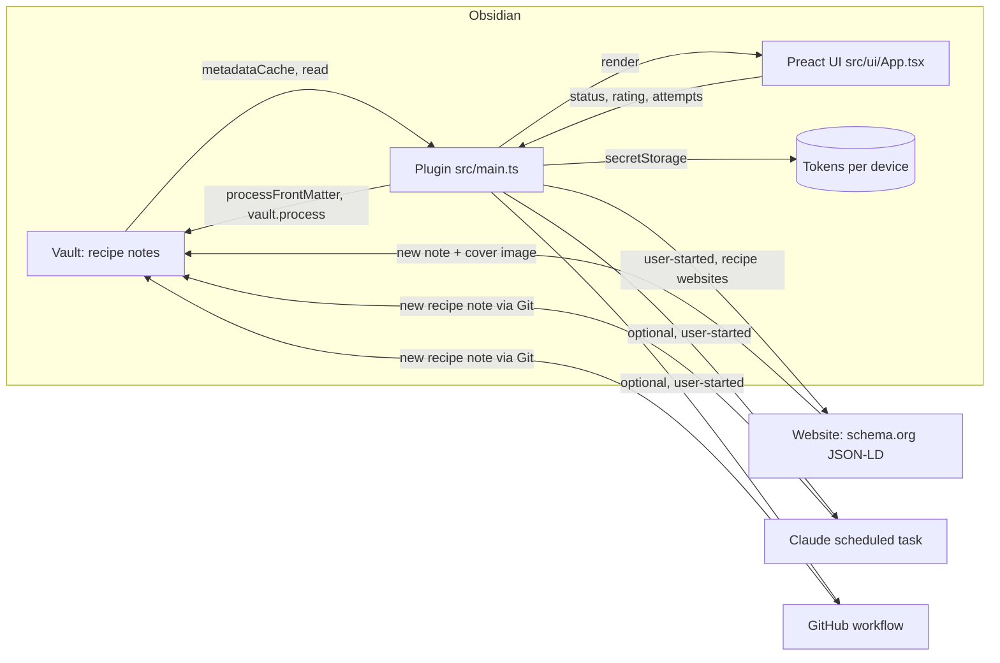

# Architecture

Better Cooking is an Obsidian plugin written in TypeScript. The UI is rendered with Preact inside one Obsidian view; all recipe logic lives in pure functions that run without Obsidian and are tested with Vitest.

## Modules

| File                                                                                               | Responsibility                                                                                                                                                                                                                                                                                                                                                                                                 | Depends on Obsidian                  |
| -------------------------------------------------------------------------------------------------- | -------------------------------------------------------------------------------------------------------------------------------------------------------------------------------------------------------------------------------------------------------------------------------------------------------------------------------------------------------------------------------------------------------------- | ------------------------------------ |
| `src/main.ts`                                                                                      | Plugin entry, view, settings tab, writes to notes, starts imports                                                                                                                                                                                                                                                                                                                                              | yes                                  |
| `src/settings.ts`                                                                                  | Settings model and defaults                                                                                                                                                                                                                                                                                                                                                                                    | no                                   |
| `src/settingsTab.ts`                                                                               | Settings tab, declared once for Obsidian's settings search (1.13+) and rendered the same way on older versions                                                                                                                                                                                                                                                                                                 | yes                                  |
| `src/settingsRows.ts`, `src/settingsAi.ts`                                                         | Building blocks of the settings tab (recipe folder, secrets) and the own-AI settings                                                                                                                                                                                                                                                                                                                           | yes                                  |
| `src/settingsDefinition.ts`                                                                        | Row to the definition of Obsidian 1.13+: `render` must return nothing, because Obsidian calls what it returns as a cleanup function                                                                                                                                                                                                                                                                            | no                                   |
| `src/migrate.ts`                                                                                   | Maps settings saved with German keys (0.2.1 and earlier) to the current keys                                                                                                                                                                                                                                                                                                                                   | no                                   |
| `src/settingsMerge.ts`, `src/settingsSync.ts`, `src/settingsViews.ts`                              | Three-way merge of an externally changed `data.json` with the settings in memory (pure), reading and writing it in one chain, and the refresh of the views (#90)                                                                                                                                                                                                                                               | no                                   |
| `src/servingsWords.ts`                                                                             | Generic servings words (Portionen, servings, Personen, people, Stück, pieces) in the language shown; recipe units stay                                                                                                                                                                                                                                                                                         | no                                   |
| `src/i18n.ts`, `src/strings/`                                                                      | Interface language (English, German by Obsidian's language) and the strings, one file per language                                                                                                                                                                                                                                                                                                             | no                                   |
| `src/folder.ts`                                                                                    | Cleans the recipe folder setting, decides which files belong to it and compares names without case and Unicode form                                                                                                                                                                                                                                                                                            | no                                   |
| `src/vaultNames.ts`                                                                                | "Is this path taken?", "where is this folder?" and "create the note under a free name" for every new file name (case-insensitive, NFC); thin layer over the vault, imports only `normalizePath` from `obsidian`                                                                                                                                                                                                | no                                   |
| `src/failedText.ts`                                                                                | Message for an exception that reaches a dialog                                                                                                                                                                                                                                                                                                                                                                 | no                                   |
| `src/coverMemory.ts`                                                                               | Remembers the cover address of a note; never throws                                                                                                                                                                                                                                                                                                                                                            | no                                   |
| `src/noteFormat.ts`                                                                                | Field names, values and headings of notes in German or English, own field names; reads both                                                                                                                                                                                                                                                                                                                    | no                                   |
| `src/extraProperties.ts`                                                                           | Extra frontmatter properties from the settings; whether a website is read locally                                                                                                                                                                                                                                                                                                                              | no                                   |
| `src/network.ts`                                                                                   | Checks that image addresses from imported pages point to public hosts                                                                                                                                                                                                                                                                                                                                          | no                                   |
| `src/importCheck.ts`                                                                               | Finds content in imported notes that other plugins could run (Templater, code, Dataview, HTML, action links, note embeds)                                                                                                                                                                                                                                                                                      | no                                   |
| `src/view.ts`                                                                                      | The Obsidian view: reads the recipe folder, renders the UI, writes status, rating and attempts                                                                                                                                                                                                                                                                                                                 | yes                                  |
| `src/noteActions.ts`                                                                               | What the view writes into recipe notes: frontmatter fields, "Made today" and its undo, attempts, opening a note                                                                                                                                                                                                                                                                                                | yes                                  |
| `src/localImport.ts`                                                                               | Local website import: loads the page and cover image (`requestUrl`), creates the note                                                                                                                                                                                                                                                                                                                          | yes                                  |
| `src/ai.ts`                                                                                        | Own AI: requests for Anthropic and OpenAI-compatible endpoints, reading and checking the answer                                                                                                                                                                                                                                                                                                                | no                                   |
| `src/translate.ts`                                                                                 | Translations with the own AI: texts of a recipe, checking the answer against the original                                                                                                                                                                                                                                                                                                                      | no                                   |
| `src/aiImport.ts`                                                                                  | Import with the own AI: page or text to the AI, answer to a note                                                                                                                                                                                                                                                                                                                                               | yes                                  |
| `src/htmlText.ts`                                                                                  | Text and meta tags from HTML, entities (shared by the website and the social media import)                                                                                                                                                                                                                                                                                                                     | no                                   |
| `src/shortLinks.ts`                                                                                | List of short link and bio page hosts that are never followed from a post                                                                                                                                                                                                                                                                                                                                      | no                                   |
| `src/commands.ts`                                                                                  | Commands of the command palette                                                                                                                                                                                                                                                                                                                                                                                | yes                                  |
| `src/cssProps.ts`                                                                                  | Sets CSS variables: setCssProps in Obsidian, style.setProperty as fallback in the preview and tests                                                                                                                                                                                                                                                                                                            | no                                   |
| `src/socialPage.ts`                                                                                | Parsers for the public page of a social media post (Instagram, TikTok, YouTube, Pinterest): caption, cover image, link; pure                                                                                                                                                                                                                                                                                   | no                                   |
| `src/socialText.ts`                                                                                | Helpers for these parsers: meta tags, JSON inside a page, first link in a caption                                                                                                                                                                                                                                                                                                                              | no                                   |
| `src/socialFlow.ts`                                                                                | Which way a social media link takes for which processor setting, address and headers of the one request                                                                                                                                                                                                                                                                                                        | no                                   |
| `src/socialStart.ts`                                                                               | The start of a social media import in the plugin: the way, the local reading, and for a set up processor the job for the first version (#133)                                                                                                                                                                                                                                                                  | yes                                  |
| `src/socialImport.ts`                                                                              | Social media import: reads the page, follows a link to a recipe website or goes on like pasted text                                                                                                                                                                                                                                                                                                            | yes (via localImport)                |
| `src/jobStart.ts`                                                                                  | Sends one job to Claude or GitHub                                                                                                                                                                                                                                                                                                                                                                              | yes                                  |
| `src/refetch.ts`                                                                                   | "Fetch again": merges a fresh reading into a note (what is replaced, what stays, the way of reading), change list, when it is allowed                                                                                                                                                                                                                                                                          |
| `src/refetchBackup.ts`                                                                             | Backup text of "Fetch again" and the remembered cover addresses                                                                                                                                                                                                                                                                                                                                                |
| `src/noteText.ts`                                                                                  | Pure text helpers for notes: split into frontmatter, header and sections, read and set frontmatter values                                                                                                                                                                                                                                                                                                      | no                                   |
| `src/fingerprint.ts`                                                                               | Import fingerprint: FNV-1a over UTF-8, per-part hashes of a note, the `import_hash` value, parts edited by hand                                                                                                                                                                                                                                                                                                | no                                   |
| `src/readWay.ts`                                                                                   | How a recipe was read (ADR 0008): the values of `import_weg` / `import_via`, reading them (`wayOfNote`), the label key of the recipe page                                                                                                                                                                                                                                                                      |
| `src/refetchService.ts`                                                                            | "Fetch again" in Obsidian: reads the page, remembers the cover address, writes backup and note                                                                                                                                                                                                                                                                                                                 | yes                                  |
| `src/feedback.ts`                                                                                  | Feedback on a recipe (#120), pure: cleaning, the request to the AI with marked blocks, the ways (own AI, processor, by hand)                                                                                                                                                                                                                                                                                   | no                                   |
| `src/feedbackService.ts`                                                                           | Feedback in Obsidian: the own AI reads again with the feedback (preview for the dialog), or an improvement job with `hinweis` to Claude or GitHub                                                                                                                                                                                                                                                              | yes                                  |
| `src/improveStart.ts`                                                                              | The one start of an improvement job: reserve, bind the note (compare-and-set), send, settle (accepted, refused, unsure); for first versions, feedback and Retry                                                                                                                                                                                                                                                | yes                                  |
| `src/jobRetry.ts`                                                                                  | "Retry" of a job: a normal job again, an improvement as a new run on its note                                                                                                                                                                                                                                                                                                                                  | yes                                  |
| `src/improve.ts`                                                                                   | Improvement proposals (ADR 0007), pure: proposal path and reading, re-rendering through the note builder, finding the note by job ID, the decision (apply, review, orphan, drop), failure text                                                                                                                                                                                                                 | no                                   |
| `src/improveApply.ts`                                                                              | Merges a proposal with `writeMerged`, moves the images, trashes the proposal, undo, "save as a new recipe"                                                                                                                                                                                                                                                                                                     | yes                                  |
| `src/improveService.ts`                                                                            | Watches `Verbesserungen/`, decides per proposal, feeds the review dialog and the cards for proposals without a recipe                                                                                                                                                                                                                                                                                          | yes                                  |
| `src/improveTarget.ts`                                                                             | Finds the note of a proposal's job, marks a timed-out improvement, cleans up leftover job images                                                                                                                                                                                                                                                                                                               | yes                                  |
| `src/improveWait.ts`                                                                               | How long a proposal without a note waits for another device to sync, and what it is after that (#156), pure                                                                                                                                                                                                                                                                                                    | no                                   |
| `src/improveNoNote.ts`                                                                             | The card of a proposal that no note carries the job ID of (waiting, unexpected, orphan)                                                                                                                                                                                                                                                                                                                        | yes                                  |
| `src/improveHost.ts`                                                                               | What the App gets for proposals: dialog calls, cards, their actions                                                                                                                                                                                                                                                                                                                                            | no                                   |
| `src/recipeStubs.ts`                                                                               | The notes of the recipe folder with what the metadata cache says (import sync, improvements)                                                                                                                                                                                                                                                                                                                   | yes                                  |
| `src/ui/improvingLine.tsx`                                                                         | The line on the page of a first version that is being improved: spinner, "Pull now", "View run" (#133)                                                                                                                                                                                                                                                                                                         | no                                   |
| `src/ui/improveBanner.tsx`                                                                         | The banner "Verbesserte Fassung bereit" and the card "Rezept nicht gefunden"                                                                                                                                                                                                                                                                                                                                   | no                                   |
| `src/ui/refetchModal.tsx`                                                                          | The dialog: reads, lists the changes, asks to confirm                                                                                                                                                                                                                                                                                                                                                          | no                                   |
| `src/textRecipe.ts`                                                                                | Structures pasted recipe text without AI (headings, quantity lines; the title loses emoji and a yield at its end, which becomes the yield; numbered steps stay whole, split only from three sentences on)                                                                                                                                                                                                      | no                                   |
| `src/headings.ts`                                                                                  | The heading words of pasted texts ("Zutaten", "Method" …) in one place for textRecipe.ts and caption.ts                                                                                                                                                                                                                                                                                                        | no                                   |
| `src/caption.ts`                                                                                   | Prepares social media captions for the text rules (#88): safe rules always (Instagram prefix, hashtag lines, number and bullet emoji), caption rules with `recipeFromText(text, { caption: true })` or for a clear caption (inline headings, one-line captions; ingredients and steps of one line are told apart); two or more hashtags at the end of the text also mark a caption; recognizes "recipe in bio" | no                                   |
| `src/stepSplit.ts`                                                                                 | Makes imported instructions fit for cooking mode (#62): one action or waiting time per step, short title, duration; limits                                                                                                                                                                                                                                                                                     | no                                   |
| `src/sentences.ts`                                                                                 | Sentence and enumeration splitting for instructions (abbreviations, decimals, ordinals)                                                                                                                                                                                                                                                                                                                        | no                                   |
| `src/stepTitle.ts`                                                                                 | Step titles from the text's own verb (German, English, du form), waiting clauses and their durations                                                                                                                                                                                                                                                                                                           | no                                   |
| `src/schemaorg.ts`                                                                                 | Finds the schema.org Recipe in a page's JSON-LD and turns it into plain fields; strips HTML                                                                                                                                                                                                                                                                                                                    | no                                   |
| `src/microdata.ts`                                                                                 | schema.org Recipe from microdata (itemscope/itemprop) in the same shape as JSON-LD, with DOMParser                                                                                                                                                                                                                                                                                                             | no                                   |
| `src/recipeNote.ts`                                                                                | Builds a recipe note in the documented format from imported data; safe file names; neutralizes page text                                                                                                                                                                                                                                                                                                       | no                                   |
| `src/parse.ts`                                                                                     | Reads a recipe note into the data model; inserts an attempt                                                                                                                                                                                                                                                                                                                                                    | no                                   |
| `src/units.ts`                                                                                     | Unit tables: known units, singular/plural forms, metric base units, `baseUnit` (units that can be compared or added up)                                                                                                                                                                                                                                                                                        | no                                   |
| `src/quantities.ts`                                                                                | Parses amounts, scales them for other servings, rounds sensibly (g, ml, fractions for spoons)                                                                                                                                                                                                                                                                                                                  | no                                   |
| `src/bottomInset.ts`                                                                               | How far Obsidian bars (status bar on desktop, navigation bar on mobile), the safe area and the keyboard cover the bottom of the view (pure functions)                                                                                                                                                                                                                                                          | no                                   |
| `src/insets.ts`                                                                                    | Measures bars, safe areas and on-screen keyboard in the view's document and sets `--rz-unten` / `--rz-tastatur` / `--rz-links` / `--rz-rechts` (also used by the preview)                                                                                                                                                                                                                                      | no                                   |
| `src/madeUndo.ts`                                                                                  | "Made today" and its undo on the frontmatter: keeps the raw values from before, compare-and-set                                                                                                                                                                                                                                                                                                                | no                                   |
| `src/shopping.ts`                                                                                  | Shopping list: items from ingredients, merging equal items, reading and writing the list note                                                                                                                                                                                                                                                                                                                  | no                                   |
| `src/containerSize.ts`                                                                             | Shopping list: size of cans, jars and packs ("1 (14 oz) can"), kept at the end of the name and compared when merging                                                                                                                                                                                                                                                                                           | no                                   |
| `src/listRecipes.ts`                                                                               | Amount per recipe on the shopping list: what was remembered about an add (servings factor, left out ingredients), the amounts per recipe of a line, taking a recipe's amount off a shared line                                                                                                                                                                                                                 | no                                   |
| `src/listRecords.ts`                                                                               | The remembered adds in `data.json`: adding, following renamed notes, cleaning up; memo of what the recipes bring                                                                                                                                                                                                                                                                                               | no                                   |
| `src/ownKeys.ts`                                                                                   | Keys from untrusted content (data.json, itemprops, JSON-LD) that must not be assigned on a plain object (`__proto__` and the like), own-property reads                                                                                                                                                                                                                                                         | no                                   |
| `src/shoppingEdit.ts`                                                                              | Shopping list page: reads the note into rows, applies the page's edits (tick, remove an item, add an own item, remove checked, remove a recipe)                                                                                                                                                                                                                                                                | no                                   |
| `src/hanging.ts`                                                                                   | Which lines hang below an entry of a note (indented deeper, up to an empty line or the next entry): shopping list items and meal plan entries                                                                                                                                                                                                                                                                  | no                                   |
| `src/noteSync.ts`                                                                                  | Which read or write of a list note may still set the view's state                                                                                                                                                                                                                                                                                                                                              | no                                   |
| `src/deletePlan.ts`                                                                                | "Delete recipe" (#119): which older versions, translations, images and meal plan entries belong to a recipe (pure)                                                                                                                                                                                                                                                                                             | no                                   |
| `src/deleteService.ts`                                                                             | "Delete recipe" in Obsidian: reads what goes, moves it to the trash, edits the meal plan                                                                                                                                                                                                                                                                                                                       | yes                                  |
| `src/recipeEdit.ts`                                                                                | Recipe editor logic: draft, changes, checks, applying a draft to the note text, undo                                                                                                                                                                                                                                                                                                                           | no                                   |
| `src/sectionDiff.ts`                                                                               | Item-level diff of a list section (ingredients, steps, tips) for the recipe editor                                                                                                                                                                                                                                                                                                                             | no                                   |
| `src/headEdit.ts`                                                                                  | Title and key facts line edits in the header of a note                                                                                                                                                                                                                                                                                                                                                         | no                                   |
| `src/lineEscape.ts`                                                                                | Escaping of typed text at the start of a list line and the reverse the reader uses                                                                                                                                                                                                                                                                                                                             | no                                   |
| `src/lineEndings.ts`                                                                               | Line endings of an edited note: unchanged lines keep theirs                                                                                                                                                                                                                                                                                                                                                    | no                                   |
| `src/recipeEditService.ts`                                                                         | Recipe editor in Obsidian: open, save with compare and set, undo                                                                                                                                                                                                                                                                                                                                               | yes                                  |
| `src/ui/recipeEditor.tsx`                                                                          | Recipe editor dialog (with editGroups.tsx, editSteps.tsx, useRecipeDraft.ts)                                                                                                                                                                                                                                                                                                                                   | no                                   |
| `src/planEdit.ts`                                                                                  | Meal plan page: reads the plan note into entry rows, applies the page's edits (move to another day, change servings, remove)                                                                                                                                                                                                                                                                                   | no                                   |
| `src/ingredientKey.ts`, `src/ingredientWords.ts`                                                   | Ingredient identity: when two names are the same ingredient (docs/shopping-identity.md); word lists and patterns shared with amounts and step matching                                                                                                                                                                                                                                                         | no                                   |
| `src/mealPlan.ts`                                                                                  | Meal plan: reading and adding day headings and entries, the next days, calendar export                                                                                                                                                                                                                                                                                                                         | no                                   |
| `src/planServings.ts`                                                                              | Meal plan: the servings of an entry as text and as the factor of "week to the shopping list", one rule for both (#109)                                                                                                                                                                                                                                                                                         | no                                   |
| `src/listNoteResolve.ts`                                                                           | Which file a list note uses: a path from the settings, otherwise existing default notes of either language (decided at every access, no stored state), otherwise the default of the note language (#76)                                                                                                                                                                                                        | no                                   |
| `src/listNotes.ts`                                                                                 | Shopping list and meal plan notes in the vault: paths, creating, changing, opening                                                                                                                                                                                                                                                                                                                             | yes                                  |
| `src/share.ts`, `src/ui/shareModal.tsx`                                                            | Share a recipe: plain text, a print page (escaped HTML in a hidden frame, desktop) and the device's share menu                                                                                                                                                                                                                                                                                                 | no / yes                             |
| `src/stepFilter.ts`                                                                                | Choice among ingredients of a step: verbs written like nouns, truncated compounds, ingredients of one name by amount and group (pure)                                                                                                                                                                                                                                                                          | no                                   |
| `src/cooking.ts`                                                                                   | Durations in steps (timers), ingredients per step, equipment                                                                                                                                                                                                                                                                                                                                                   | no                                   |
| `src/cookingResume.ts`                                                                             | Where cooking mode stopped per recipe: storage format, start step, pruning (clock and storage are passed in)                                                                                                                                                                                                                                                                                                   | no                                   |
| `src/timers.ts`                                                                                    | Cooking timers as a model: start, pause, continue, +1 minute, cancel, which are due, remaining time, order, reading the stored list (no clock, `now` is passed in)                                                                                                                                                                                                                                             | no                                   |
| `src/timerStore.ts`                                                                                | The list of timers with one timeout per running timer, saving on every change, reporting the ones that are over (clock, storage and alert are passed in)                                                                                                                                                                                                                                                       | no (runs in the browser preview too) |
| `src/timerService.ts`                                                                              | Timers of the plugin: local storage, notice with Stop, system notification (desktop), gong, status bar, screen lock, check when the window is visible again                                                                                                                                                                                                                                                    | yes                                  |
| `src/timerSound.ts`, `src/wakeLock.ts`                                                             | The gong (WebAudio, repeated, at most 2 minutes) and the volume steps; the screen lock with several reasons that is requested again when the page is visible again                                                                                                                                                                                                                                             | no                                   |
| `src/settingsTimer.ts`                                                                             | Settings group "Cooking mode": timer volume and a test gong                                                                                                                                                                                                                                                                                                                                                    | yes                                  |
| `src/ui/timerBar.tsx`, `src/ui/timerBubble.tsx`, `src/ui/useBubblePlace.ts`, `src/ui/useTimers.ts` | Timer bubble and list of the view, drag and remembered position, and the hook that follows the store (one tick per second only while a timer runs and the view is visible)                                                                                                                                                                                                                                     | no (runs in the browser preview too) |
| `src/search.ts`                                                                                    | Search index (MiniSearch: BM25+, prefix, fuzzy), German normalization, compound words, OR fallback                                                                                                                                                                                                                                                                                                             | no                                   |
| `src/source.ts`                                                                                    | Detects the kind of source (website, Instagram, TikTok, YouTube, Facebook, Pinterest, text) and duplicate keys                                                                                                                                                                                                                                                                                                 | no                                   |
| `src/processor.ts`                                                                                 | Builds requests for the processors, evaluates answers, tracks open import jobs                                                                                                                                                                                                                                                                                                                                 | no                                   |
| `src/importSync.ts`                                                                                | When a waiting import triggers a sync (pace, limits, allowed command, device)                                                                                                                                                                                                                                                                                                                                  | no                                   |
| `src/importSyncService.ts`                                                                         | Timer, foreground event and the pull command of Obsidian Git while an import waits; device ID                                                                                                                                                                                                                                                                                                                  | yes                                  |
| `src/development.ts`                                                                               | Development builds only: reloads the plugin after `pnpm dev` rebuilt it; not in release builds                                                                                                                                                                                                                                                                                                                 | yes                                  |
| `src/reload.ts`                                                                                    | Decides when a rebuilt plugin may reload itself                                                                                                                                                                                                                                                                                                                                                                | no                                   |
| `src/types.ts`                                                                                     | Data model                                                                                                                                                                                                                                                                                                                                                                                                     | no                                   |
| `src/ui/App.tsx`                                                                                   | State (open recipe, cooking mode, timers, dialogs), keyboard shortcuts and layout                                                                                                                                                                                                                                                                                                                              | no (runs in the browser preview too) |
| `src/ui/lists.ts`                                                                                  | Lists of the overview: counts, categories, filter and sort, import cards per list, list name                                                                                                                                                                                                                                                                                                                   | no                                   |
| `src/ui/overview.tsx`, `src/ui/sidebar.tsx`                                                        | Overview with cards, sidebar with lists and search, view settings                                                                                                                                                                                                                                                                                                                                              | no (runs in the browser preview too) |
| `src/ui/recipeMenu.tsx`, `src/ui/deleteModal.tsx`                                                  | The "⋯" menu of the recipe page and the dialog of "Delete recipe"                                                                                                                                                                                                                                                                                                                                              | no                                   |
| `src/ui/recipePage.tsx`, `src/ui/ingredients.tsx`                                                  | Recipe page, servings, ingredient list, steps with timers                                                                                                                                                                                                                                                                                                                                                      | no (runs in the browser preview too) |
| `src/ui/cookingMode.tsx`                                                                           | Cooking mode (the timer bubble is `src/ui/timerBar.tsx`)                                                                                                                                                                                                                                                                                                                                                       | no (runs in the browser preview too) |
| `src/tapZones.ts`                                                                                  | Cooking mode taps: is a press a tap and where to, one step function for keys and taps                                                                                                                                                                                                                                                                                                                          | no                                   |
| `src/ui/useCookingResume.ts`                                                                       | State of cooking mode (`CookingState`), start at the remembered step, a note of every real step change (opening writes nothing)                                                                                                                                                                                                                                                                                | no (runs in the browser preview too) |
| `src/ui/useTapZones.ts`, `src/ui/tapZoneOverlay.tsx`                                               | Cooking mode: tap on the sides of the step area, decided on `pointerup` (touch and pen, not the mouse; no dead edge strip; small controls keep their own tap), the click after a turn is swallowed, pulse and one-time hint. No swipe gestures: they open Obsidian's sidebars                                                                                                                                  | no (runs in the browser preview too) |
| `src/ui/madeButton.tsx`                                                                            | "Made today" button with the date of the last time and a short window for Undo                                                                                                                                                                                                                                                                                                                                 | no (runs in the browser preview too) |
| `src/ui/jobs.tsx`, `src/ui/attempt.tsx`                                                            | Import dialog and import jobs, dialog for an attempt                                                                                                                                                                                                                                                                                                                                                           | no (runs in the browser preview too) |
| `src/ui/shared.tsx`, `src/ui/icons.tsx`, `src/ui/svg.ts`, `src/ui/keyboard.ts`                     | Shared building blocks, icons, SVG sanitizing, keyboard scope                                                                                                                                                                                                                                                                                                                                                  | no (runs in the browser preview too) |
| `src/plugin.css`                                                                                   | Layout, the "kitchen" palette (Style Settings block at the top), the "calm" palette, the "obsidian" palette; `scripts/build-styles.mjs` adds fonts                                                                                                                                                                                                                                                             | no                                   |

## What the plugin writes

Only inside the recipe folder. In existing recipe notes:

- frontmatter fields `status`, `rating`, `lastMade`, `updated` (via `fileManager.processFrontMatter`), under the name the note already uses (German, English or own name, `src/noteFormat.ts`), otherwise under the name of the setting "Language of new notes",
- the frontmatter field `import_weg` / `import_via` (how the recipe was read, [ADR 0008](adr/0008-record-how-a-recipe-was-read.md)): in every note the plugin creates (website, pasted text, caption, own AI, translation, first version, a proposal saved as a recipe), and in an existing note only when "Fetch again", feedback with the own AI or an applied improvement takes at least one recipe part from the new reading (never on its own); see "Fetch again" below,
- the `## Versuche` / `## Attempts` section, where a new attempt is inserted at the top (via `vault.process`); if it is missing, it is created in the note format's language,
- the first `# ` line, frontmatter fields (yield, servings, times, category, `import_hash` on the first edit of an imported note) and the first Ingredients, Steps and Tips sections, only the parts the user changed in the recipe editor and saved (via `vault.process`, see below),
- the writes of improvements outside a merge, each a compare-and-set that is only done if it would change the note: the state without a job with a reason appended (`closeUnimproved`) when an improvement failed, timed out or was discarded, or a merge was undone (`src/improve.ts`, `src/improveTarget.ts`, `src/improveReview.ts`); the new job ID in `auftrag` and `import: offen` for a retry or for feedback (`rebindJob`, a note without `auftrag` can take one; a note without an `import` field gets it: `offen` now and, when no improvement comes, `fertig` or `teilweise` by its content through `closeUnimproved`: so a note that had no `import` field has one afterwards); Undo of a merge (the text before, only if the note is still exactly what the merge wrote, with `teilweise` instead of `offen`); the proposal's images moved to `<note> Titelbild.<ext>` / `<note> Ablauf.svg`; the deletion of proposals and of images that go with them,
- the parts of an improvement proposal (title, description, yield, times, ingredients, steps, tips, `import`, `import_error`, a missing cover or `## Ablauf`; `## Ablauf` before the first section) from a file in `Verbesserungen/`, with the rules of "Fetch again" below. The plugin deletes the proposal and its images afterwards, and writes `Vorversionen/` copies. The merge updates `import_hash` like "Fetch again" does.

The recipe editor (issue #131: `src/recipeEdit.ts`, `src/sectionDiff.ts`, `src/headEdit.ts`, `src/recipeEditService.ts`, `src/ui/recipeEditor.tsx`) writes a recipe note only after "Save" in its dialog, in one `vault.process` per save, and only the parts that differ from the draft the dialog was opened with: the first `# ` line of the header (never the file name), the frontmatter fields yield, active time, total time and category under the name the note already uses (not the category if that field is a YAML list), the key facts line (`keyFactsLine`, in the language of the note) only if yield or times changed, and the first section of each kind (ingredients, steps, tips; a missing one is created before attempts and notes), plus `updated`. A section is never written from parsed values: its raw lines are matched to the wanted items by their text (longest common subsequence, then moved items); unchanged items keep their raw lines (checkbox, indentation, hanging lines, `### Group` and bold group lines, hints); an edited item becomes one line in the format of `recipeNote` (an edited ingredient keeps its hanging lines); new items go after the item before them; removed items go with their hanging lines; step numbers change only if the order or count changed. The page and the editor read the list sections with one function (`listEntries` in `src/parse.ts`: entries with their line numbers, hanging lines included), so a text the page shows is the text the editor compares; an edited item keeps the start of its line (indentation, marker, checkbox, number). Typed text becomes one line, a start that would read as structure is escaped with a backslash by one rule (`LINE_START` in `src/lineEscape.ts`, also used by `defuse` for imported text; the reader takes exactly that backslash off again), inline Markdown stays. A note with a `servings` field (`portionen`) gets it as an own field in the editor (it drives the servings control); otherwise only yield is edited. For ingredients, two entries count as an edit of each other only if they share at least half of their words (amounts and units left out), steps and tips are paired by position when the same number of old and new entries lie between two unchanged ones; otherwise the old one is removed with its hanging lines and the new one inserted. Line endings: lines that did not change keep their own, new lines get the common one; a byte order mark stays (and is ignored by the readers). A group heading with no ingredient below it is not touched. A save is refused if the two readers of the frontmatter disagree about where it ends. If a part changed meanwhile, the editor takes the new text for the parts the user did not change and asks per changed part which version counts; nothing is overwritten unasked. Each changed part is compared with the draft the dialog was opened with before writing; if one differs (another device), nothing is written. On the first edit of an imported note (with `import` or a job) without a valid `import_hash`, the field is written with the fingerprint of the note before the edit (ADR 0006); an existing one stays, a value of another version is never overwritten, notes that were not imported get none. Undo restores the old text only while the note is exactly what the save wrote (token in memory per note). Attempts, notes, images, own sections and own frontmatter are not touched.

The shopping list note (setting "Shopping list", at the top of the vault unless the setting names a path; see "List note files" below): created when the user adds the first recipe; afterwards only its checkbox lines are changed or appended (`src/shopping.ts`, via `vault.process`). With the setting "Stores", new items go into `## <Store>` sections (created at the end, with an empty line before); an open line above the first section that is only counted up moves into the section of a store that fits by now, unless indented lines hang below it, and a line the user put in a section stays there. The shopping list page (`src/ui/shoppingPage.tsx`) changes the same lines through `src/shoppingEdit.ts`, all via `vault.process`. It ticks or unticks a checkbox line, removes a line together with the note lines hanging below it (lines indented deeper than the item, up to the next checkbox line), removes all checked lines (with their hanging lines), removes all lines only for one recipe (a line shared with other recipes loses that recipe's name and, where the amount per recipe is known and adds up to the line, exactly the recipe's amount; otherwise only the name and it keeps its amount; checked lines keep their amount), and adds a line the user typed (merged and placed like an ingredient; a typed " · " is written as " - ", so it never becomes a recipe). A line is found by its exact text and its number among identical lines, never by line number; a click on a row that moved in the meantime can hit the identical line that took its number (accepted); an edit whose line is gone changes nothing, and an edit that changes nothing leaves the text untouched, line endings included. Only adding an own item creates the note if it does not exist. It is never read as a recipe. The same holds for the meal plan note (setting "Meal plan", see "List note files" below): day headings and entry lines are added (`src/mealPlan.ts`). The meal plan page (`src/ui/planPage.tsx`) changes the plan note through `src/planEdit.ts`, all via `vault.process`: it moves an entry line to another day (a new day heading is created in date order with the plugin's format, and the entry goes below the last line of the day if the day exists), changes the amount in the entry's servings text (only the number, a range becomes one number; an entry without servings gets " · n"), removes an entry, and puts a removed entry back (the "Undo" of a few seconds after removing). The servings of an entry are shown and turned into the shopping list factor by one pure function (`planServings`, `src/planServings.ts`, #109): the unit written in the entry wins for display (the recipe's unit only for a bare number or no servings text; a range is passed on), and the factor is the entry's number divided by the recipe's amount, except where the entry and the recipe clearly count different things: servings or people (`isServingsWord` in `src/servingsWords.ts`: Portionen, servings, portions, Personen, people, Pers., Port.; "Stück"/pieces is not one, although `isYieldUnit` translates it like the others) against a concrete unit, or the other way round ("8 servings" for "1 loaf", "4 Portionen" for "24 Stück"). Then the factor is 1 (the recipe as written), the plus/minus control steps in whole numbers of the entry, and the card says "Shopping list: 1 loaf" under the number. Free text after the unit ("8 Portionen (Gäste)", "1 loaf (about 10 slices)") is left out of the comparison. A unit of a yield with a known plural (table `YIELD_FORMS` in `src/servingsWords.ts`, used by `servingsUnitText` for the plan, the recipe page and new entry lines; it is separate from the ingredient units in `src/units.ts`) is shown in the plural for a number other than 1, anything else as written. The plus/minus control only replaces the number. An entry is its line plus the lines hanging below it (indented deeper, up to an empty line or the next entry line, `src/hanging.ts`); they move and go with it. A day heading that the plugin wrote (`## <date> · <weekday>`) is removed when its day is left without any content; a heading with text of the user's, or a day with other text below the entries, stays. An entry is found by its day, its exact text and its number among the identical lines of that day (in all sections of that day); an edit whose entry is gone changes nothing, and an edit that changes nothing leaves the text untouched, line endings included. the command "Export meal plan as calendar file" writes `<plan name>.ics` next to it.

**Amount per recipe on the shopping list (#68).** The note stays readable and holds only the merged line (`500 g Mehl · Brötchen, Hefezopf`). How much belongs to which recipe is not in the note but in `data.json` (`listRecipes`: list note path → recipe note path → `{ parts: [{ factor, skipped, sig, count }], title, at, unsure? }`). It is written by the recipe page's "To the shopping list" and by the meal plan's "week to the shopping list", the only ways a recipe gets onto the list, after the list was written (`ListRecords`, `src/listRecords.ts`; nothing is remembered for a failed write). A recipe whose title is not on an open line of the list before the add starts again (an older record belongs to an older add). If it is on the list but the open lines no longer match its record (an ingredient line removed or ticked, or a line that no longer adds up; `fits` in `src/listRecords.ts`, which checks lines shared with other recipes only as far as those are known), the record is marked `unsure`: no amounts and removing takes only the name, until the recipe is off the list. Otherwise adding the same recipe again adds its amounts again, as the list does, so the factors of the same add (same left out ingredients) are summed and a different add is another part. A changed ingredient list (`sig`, a fingerprint) drops the older parts. Records are never changed in place (the settings in memory are the base of the merge of #90, which is a deep copy). The amounts are worked out again each time (`amountsFor` in `src/listRecipes.ts`, pure): the recipe's ingredients with the part's factor and skips are made into items by `itemsFromRecipe` and joined to the line with `merge` of `src/shopping.ts`, so identity (`ingredientKey`) and units are those of merging, with no second logic. The page shows the amounts of a line only when they add up to it: for every recipe of the line a record exists, its title fits exactly one note, its ingredients are those of the add, the sum differs from the line by at most half a rounding step per rounding (every add was rounded when it was written, `count` per part; the step comes from `roundingStep` in `src/quantities.ts`, the table `roundBase` uses) and no recipe brings less than that tolerance (such a share cannot be told from rounding). Otherwise the page shows the names only, as before. `removeRecipe` takes the line's amount down to the sum of the other recipes' amounts only under the same condition (unit and name stay, a counted item at one or less goes back to the singular; checked lines keep their amount); otherwise it takes only the name off, as before.

Records follow a renamed recipe or list note and go with a deleted one. Records are dropped only from text the plugin has just written itself, in the same step (`editWithRecords`: a record whose title is on no line of the new text goes, loaded recipe or not), never from text it merely read, so a list that another device has not synced yet costs nothing. At start, once the notes are known, records of notes that no longer exist go, and the records of a list that is not the one in use 30 days after their last add (`at`). `merge3` joins them like `coverUrls`; keys that change prototypes are dropped when reading and merging (`src/ownKeys.ts`).

**Limits.** Nothing is guessed: a line added before this version, added on a device that did not sync its data.json yet, whose recipe was edited or renamed, or that the user changed by more than the tolerance, shows no amounts. A recipe title that contains ", " or " · " is split by reading the list, so it never matches. An own item the user typed that merges into a line (the line has more than the recipes bring) counts as a change by hand beyond the tolerance. Two devices that add the same recipe at the same time offline may end with one record (the file wins). A list text that is behind another device's (sync not done) shows fewer amounts, never wrong ones, and keeps all records. Only recipes of the recipe folder have amounts: a recipe note outside it (for instance one linked from the meal plan) is remembered but not found by the page.

### List note files (#76)

Nothing is stored to decide which file a list note uses: it is worked out again at every access (`resolveListNote`, `src/listNoteResolve.ts`; `choice` in `src/listNotes.ts`), so a change of the interface or note language never switches the file and a note that shows up later (sync, created by hand) counts at once. A path the user set in the settings always wins (empty: automatic). Otherwise the notes at the top of the vault with a default name of either language (`Einkaufsliste.md`, `Shopping list.md`, `Wochenplan.md`, `Meal plan.md`, any letter case) compete: the only one; the one with entries; none with entries: the one of the note language. Only when two notes compete are they read (`settle`, with `cachedRead`, counted again only after a note changed) and their entries counted (`countListEntries`); until counted the note of the note language is used, never "0 entries". Without any note the default of the note language is created at the first write and nothing is stored. If two notes have entries, the one with more entries (the newer one on a tie) is used, and that provisional choice is kept in memory for as long as the conflict lasts (the page's own changes and their undo stay in the same file). The page shows a notice with both names and a button each; the choice is stored as the path. Nothing is merged or deleted. A stored path follows its note when the user renames it; so does the automatically used file, which then becomes the user's choice. Deleting a note leaves a stored path: the note is created there again at the next write. The settings show the stored path (empty: automatic) and "In use: <file>". Only the top level of the vault is searched without regard to letter case; a path with a folder must match exactly.

"Fetch again" on a recipe page (`src/refetch.ts`, `src/refetchService.ts`, `src/ui/refetchModal.tsx`, issue #63) is the one place where the plugin rewrites imported content, and only after the user confirmed a dialog that lists what changes (sections, number of ingredients and steps, old to new). It is offered for imported notes (with an `import` or `job` field) whose `source` is a recipe page, never for translations. It reads the page in the plugin; if the page has no recipe data, the dialog offers a button "Read with my AI" and calls the AI only when it is pressed (the page text then goes to the AI provider). In the existing note it:

- keeps what the user edited by hand ([ADR 0006](adr/0006-hand-edits-and-the-import-fingerprint.md)): every plugin import writes the frontmatter field `import_hash` (the same name in both languages, an own name is possible), `"v1;title:abc;ingredients:def;…"`, a short FNV-1a hash (over UTF-8) per imported part (title, description, yield, times, ingredients, steps, tips). Title, description, yield and times are hashed by their parsed value; ingredients, steps and tips by the normalised lines of their section (the first section of that kind, found by heading in either language; per line trimmed, spaces collapsed, list marker, step number and then checkbox removed, Unicode NFC, empty lines dropped; everything else counts), which is what the merge replaces (`src/fingerprint.ts`). A part whose current hash differs from the stored one counts as edited by hand, wherever it was changed. The dialog marks such a part "edited by you" with a checkbox "Replace your edit" (off by default); a part that is not replaced stays as it is, and with nothing left to replace the button is locked with a hint. `replacedParts` (`src/refetch.ts`) is the one decision which parts are really replaced (what the source gave, minus the kept parts); the merge and the fingerprint use it. After the write the field holds the new hash of every part that was really replaced; all other parts keep the stored hash, so a kept edit is found again next time (unless it now equals the source's). All seven parts are written at import, an empty part as the hash of an empty text. Unknown but well-formed entries are carried along, a value of another version is never overwritten. The key facts line is written again only when yield or times were replaced. A note without a valid field (imported before, by a processor, an unknown version or a broken value) is not protected: everything is replaced and the backup keeps the old version, as before. The plugin never writes the field into a processor's note on arrival,
- records how the new text was read: `import_weg` / `import_via` is set to `page` or `ai` (an applied improvement: `processor`), also in a note that had none, but only if the run took at least one recipe part or the image; otherwise the field stays as it is. It is not part of the fingerprint, no hand edit and no change of its own ([ADR 0008](adr/0008-record-how-a-recipe-was-read.md)),
- merges the header line by line: a real new title (never the placeholder "Rezept"), a new description, the cover embed and the yield and time line (written from the merged frontmatter) replace the old lines; the source line and lines the user added stay,
- replaces `## Zutaten`, `## Schritte` and `## Tipps` (only when the source gives them; only the first section of each name) and the frontmatter fields `yield`, `timeActive`, `timeTotal` and `image`; `category` and `author` only when the note has them empty and never into a field that has an own name (`category: tags` stays the user's); `import` and `import_error` only when the note has them; `updated`,
- keeps everything else as it was, including line endings: `status`, `rating`, `lastMade`, `created`, `source`, extra properties, `## Versuche`, `## Notizen`, `## Bilder`, `## Ablauf` and every section of its own,
- copies the old note into the subfolder `Vorversionen/` of the recipe folder (`<name> (Vorversion YYYY-MM-DD).md`, a number is added if it exists) directly before it writes, from the note as it is then, and aborts if the note changed in between (the dialog then reads the page again). The copy is the one documented exception to "unchanged": the job ID is removed and a field `vorversion` / `previous_version` (link to the recipe) is added. The subfolder is not read as recipes, like `Bilder/`. The plugin deletes old versions only on an explicit "Delete recipe" (below), otherwise the user does; queries in Dataview or Bases should leave out the subfolder or notes with that field,
- loads a new cover image only when the page's image address differs from the one remembered for the note (`coverUrls` in `data.json`, set at import and at each update, moved on rename and removed on delete or when the note is gone at start; with no remembered address only a note without an image gets one). The old file stays; if writing fails, the files this run created (new image, backup) are removed again.

**Feedback (#120, `src/feedback.ts`, `src/feedbackService.ts`, `src/ui/feedbackPanel.tsx`).** The menu item "Something wrong? Fetch again with feedback" opens the same dialog in feedback mode: a text field "What is wrong?" (at most 1000 characters, cleaned to one paragraph), nothing is read before the user confirms. The way depends on the setup (`feedbackWays`): with the own AI "Read again with my AI": `Refetcher.previewFeedback` gives the AI the page text (website; if the page cannot be read, the note's own text), the caption read again (Instagram, TikTok, YouTube, Pinterest) or the note's own text (no source, Facebook), plus the note's recipe and the feedback (`recipeWithAi` with `feedback`, so a page with schema.org data is read by the AI too, and the AI may take facts from the feedback). The result is the normal change list of "Fetch again" (`src/ui/changeList.tsx`) with the hand-edit choices (ADR 0006) and the new text of every changed part (`newTexts`); "Update" writes with backup through `writeMerged`. The request marks its blocks with a nonce per request and tells the AI to leave everything the feedback does not concern unchanged. It is refused while an improvement runs or a proposal waits for the note (`improvementBusy`); a changed note after the preview locks the list, nothing is read again without a click. Without an own AI but with Claude or GitHub: "Send to Claude" starts an improvement job (ADR 0007, amendment 27.11.2026) with the one start of all improvement jobs (`src/improveStart.ts`, shared with the first version of a social post and with "Retry"): the job is reserved (`Job.starting`), the note gets the new `auftrag` and `import: offen` by compare-and-set (`rebindJob`; a note without `auftrag` can take one), the request is sent, and the real job takes the reservation's place. A clear refusal removes the reservation and closes the note with `closeUnimproved` (the state its content has); no answer at all turns the reservation into a normal job marked `unsure`, so the time limit and "Retry" apply and a note that says `offen` is never without a job. The job carries `hinweis`, and the note's `quelle` only if it is a real link (otherwise the recipe text). A failed or timed-out earlier run is replaced like a retry (`retryOf`, `src/jobRetry.ts`); a retry of an improvement is refused if the note no longer carries the job ID. A proposal whose job ID a note carries is never offered as a new recipe ("claimed" card, discard only; it is looked at again when its job becomes known). Feedback on a note without a readable fingerprint counts every part as edited by the user (`unknownEdits`, also for proposals): replaced only where ticked. With nothing set up the dialog says so and offers the editor. Translations and notes in `Vorversionen/` are not offered.

Claude and the GitHub action are not used for this: their contract (import-contract.md) creates new notes and, for a known source, only sets the job ID, so the plugin offers "Fetch again" for pages it reads itself (and the own AI for pages without recipe data), and the dialog says so.

**Delete recipe (#119)** (`src/deletePlan.ts`, `src/deleteService.ts`, `src/ui/deleteModal.tsx`, menu "⋯" on the recipe page) deletes a recipe note and what belongs to it, only after the user confirmed a dialog that lists what goes. (The other place that deletes notes is `src/failureService.ts`, for failure notes.) Everything goes through `fileManager.trashFile`, so Obsidian's setting "Deleted files" decides whether it lands in a trash or is deleted for good; the dialog says so, and that removed meal plan entries cannot be restored. What belongs to a recipe (`planDelete`, one function for the plugin and the preview):

- the note itself (first; if that fails nothing else happens);
- its translations: notes whose translation link (`[[…]]`, quoted or not, `linkValue` in `src/translations.ts`; plain text is no link) leads to it, as Obsidian resolves it (`getFirstLinkpathDest`; a link that leads nowhere points to no recipe); a checkbox, on by default. The overview lists a translation by the same name rule (`isTranslationOf`);
- its older versions: files directly in `<recipe folder>/Vorversionen/` whose field `vorversion` / `previous_version` links to the recipe, or, without that field, whose name starts with `<name> (Vorversion `;
- images in `<recipe folder>/Bilder/` or below it that the going notes (the recipe, translations that go, older versions) link to and that no kept note and no canvas links to (`metadataCache.resolvedLinks`; canvases: the `file` nodes and the `[[…]]`, `![[…]]`, `` and `` links in text nodes, resolved from the canvas; read in parallel and remembered by modification time); never a file outside `Bilder/`. Without a safe reading of the links no image is taken: when, at the moment of the scan, the layout is not ready or a markdown note has no cache yet (Obsidian is still indexing), or when a canvas cannot be read; the dialog says so, and says that translations and older versions may be missing while the cache is incomplete. Limit: images that a kept note shows only with an HTML `` tag, or whose path only stands in a code block, are not seen as used; the dialog lists every image that goes;
- the entries of the meal plan from today on (past days stay as text), found by the links of the plan note as Obsidian resolves them before the files go; hanging lines (also the user's own notes below an entry) and the plugin's own empty day headings go with them, a heading with text of the user's stays (`removeRecipe` in `src/planEdit.ts`).

Only what the dialog showed is deleted: `run` gets the paths and plan link texts of the preview and deletes the intersection with what it reads again; while a new preview is read (the checkbox was switched) the button is disabled. If a later step fails, the notice names what is left. Open items on the shopping list stay; the amounts per recipe (`listRecipes`) and the remembered cover address (`coverUrls`) go through the delete events like for any deleted note. The cooking position of the recipe is forgotten; timers of the recipe keep running and ringing, and opening a recipe that is gone (from a notification) says so in a notice. The App closes the recipe page and its dialog when the open recipe disappears from the list, follows a rename of the open recipe (`renamed` from the view's rename event), and does not open a recipe again if a note with the same path comes back; `run` returns the paths that are gone and the cooking positions of all of them are forgotten. A translation whose original is gone is listed in the overview as a recipe of its own.

**Improvements arrive as proposals (#132, [ADR 0007](adr/0007-improvements-arrive-as-proposals.md)).** A processor never rewrites a note. For a job with `improve` (request field `verbessern`) it writes `Verbesserungen/<job id>.md` and its images (`Bilder/<job id> Titelbild.webp`, `Bilder/<job id> Ablauf.svg`), and `ImproveService` (`src/improveService.ts`) merges it into the note that carries the job ID in `auftrag`, with `writeMerged` and the rules of "Fetch again" above. It watches create and modify under `<recipe folder>/Verbesserungen/` and scans once when the layout is ready; a proposal is handled 1.5 seconds after its last event, and one that names an image that has not arrived yet waits up to a minute for it. The decision (`improveDecision`, `src/improve.ts`): job dropped (`Job.dropped`, set when the note was deleted on purpose) gives "drop" (proposal and images deleted quietly); no note with the job ID gives "orphan" (kept, shown in the import area; what the card is, `orphanWait` in `src/improveWait.ts` and `cardWithoutNote` in `src/improveNoNote.ts` (#156): for the first 24 hours after the first sight on this device a neutral card "Wartet auf ein anderes Gerät" with "Discard" only (and a link to a recipe with the same source), then "Nicht mehr erwartet" (end state, "Discard" and the link) if a recipe with the same source exists (translations and failure notes do not count), otherwise "Rezept nicht gefunden" with "Save as a new recipe" and "Discard"); the device that started the job (`Job.device`), with no part edited by hand that would change (`planRefetch`) and no import-check finding in the proposal, gives "apply"; everything else (another device, an unknown job, hand edits that would change, findings) gives "review". "Apply" merges at once with nothing replaced, so edited parts stay, sets `import` and `import_error` from the proposal (also if the note had none, as `offen` is replaced), takes the proposal's cover only if the note has none and its `## Ablauf` only if the note has none (the images are renamed to `<note> Titelbild.webp` and `<note> Ablauf.svg`; an image not taken is deleted), copies the old note to `Vorversionen/` first, deletes the proposal, and shows "Verbessert: <title>" with Undo. Undo writes the old text back only if the note is still exactly what the merge wrote (compare-and-set; the image files stay). "Review" sets `improvement` on the recipe view, so its page shows a banner that opens the "Fetch again" dialog fed with the proposal (same changes, same "Replace your edit" choices); applying from there deletes the proposal. A proposal is never executed or copied: `schemaFromRecipe` reads it into the plugin's data structure and `recipeNote` writes every line again, so Templater, links, embeds and HTML are defused like in an import. A proposal with `import: fehler` leaves the first version: only the device that started the job closes the note in the state it has without a job (`fertig`, or `teilweise` with what is missing) and the reason appended (`closeUnimproved`, `src/improve.ts`, the one function for every way that no improvement comes) (compare-and-set on the job ID and `offen`), deletes the proposal and shows a notice. `Verbesserungen/` is no recipe folder content (`isRecipeFile` reads only files directly in the folder, so neither the list, the search nor the counts see it). `checkJobs` closes an improvement job only by its proposal (`proposals` argument; the `offen` note and a newer note with the same source do not count); the sync while waiting (#82) keeps pulling until the proposal is there. The job is kept until the service has dealt with the proposal (`settleJobs` never announces "recipe arrived" for it) and is then removed on the starting device.

Which proposal is trusted and who acts. A proposal counts only if its file name is a job ID of the form `newJobId` makes (`isJobId`, `src/processor.ts`) and equals its `auftrag` (`readProposal(...).valid`); otherwise it is an "invalid proposal" card with only "Discard" (the file, no images, no note; never "save as a recipe"). Images are looked up only by `<job id> Titelbild.<ext>` / `<job id> Ablauf.svg` in `Bilder/` of that checked ID. The note is found (`findTarget`, `src/improveTarget.ts`: metadata cache, or reading the file where the cache has no entry; a note that says "failed" is skipped only if a real parse shows no content) only for a job known as an open improvement job (`Job.improve`) or for a note that says `import: offen`; with two notes the one that says "offen" wins, otherwise the first by path. A proposal of a run that a retry replaced (its ID is in the `retryOf` of a job) and one of a dropped job are deleted quietly with their images. No note: the proposal waits two minutes (notes may sync later; counted from the first sight of the proposal on this device, kept in Obsidian's local storage, at most 200 paths, `src/improveSeen.ts`) and then shows as a card (waiting for 24 hours, looked at again every ten minutes at most; then an end state without a timer, see the decision above); a proposal that waited (during the grace period or on such a card) and whose note arrives while its job is unknown here is treated like the job of another device (the arrival time is kept in Obsidian's local storage like the first sight, `ARRIVED_KEY` in `src/improveSeen.ts`, so a restart keeps it: the ten minutes count from the arrival of the note, `toReview`); a failed proposal of an own job without a note is deleted. "Apply" automatically needs `Job.improve === true` and the job's device to be this device, a fingerprint this version can read (`fingerprintKnown`, otherwise "review"), no hand-edited part that would change and no findings. Everything else is a **review**: the job keeps `review: { proposal, target }` in `data.json` (so it survives a restart and reaches the other devices, and the job stays until the user applies or discards; a job this device does not know gets a hidden record) and the banner shows on exactly that note (a copy with the same `auftrag` has none). A review follows its note when it is renamed, and ends when its proposal file is deleted (also elsewhere). On another device, a job that is open and not reviewed yet holds the proposal back: only a hint ("applied on the device that started the import") until ten minutes after the first sight. The review dialog lists the changes of `planRefetch` including `state` (import state or reason) and `timeline`, the new text of each changed part, and "Discard" (proposal and its images deleted, the first version closed like a failed improvement if it still says "offen" for this job, job closed); applying from it closes the job on every device. A failed proposal is written by every device into a note that says "offen" with the job ID (compare-and-set, and only after a read from the cache shows it would change); the device that started the job also closes the job and tells the user. The timeout of an improvement job closes the first version like a failed improvement (device that started it, once: the job is marked `timedOut`); a job of a deleted note (`dropped`) goes after its time if no proposal came. Undo writes the first version back closed like a failed improvement (the job is closed). A first version that says "offen" without an open improvement job (one with a review is open) is shown as partial. Deleting a recipe sets `dropped` on its open improvement job, or removes a job with a review together with the waiting proposal and its images (`dropImprovement`, `src/deleteService.ts`); a dropped job has no card and the sync does not wait for it. A retry of an improvement job starts a run with a **new job ID** (`retryOf` remembers the old one), then sets the note's `auftrag` to it, only if the note still carries the old one (`rebind`). One proposal file per ID is possible; copies from a sync conflict are invalid. Images are moved to the note's name before the note is written (back if it is not written); if a move fails, the note links to the image's old name and that image is kept. Images of a proposal that was dealt with and arrive later are left alone (harmless; deleting them was judged riskier). Events are filtered (`src/improveEvents.ts`): only proposal files and notes of the recipe folder that appear, are renamed or change their `auftrag` or `import`; an orphan card only looks again for a new or renamed note, a waiting or unexpected card also for a change of `auftrag` or `import` and for a deleted note (so a card never keeps a dead link), and when the jobs change on another device (`jobsChanged`). `ImproveService.stop()` (called from `onunload`) clears every timer and stops scheduling.

New notes only come from an import the user started:

- **Recipe website with schema.org data** (`src/localImport.ts`), unless the setting "Rezeptseiten selbst lesen" is off and a processor is active (not with "None"): one new note `<title>.md` in the recipe folder (with " 2", " 3" … if the name exists) and its cover image `Bilder/<title> Titelbild.<jpg|png|webp|gif|avif>`. Existing files are never overwritten; the folders are created if missing. Field names, values and headings follow the setting "Language of new notes" and "Own field names". The note's frontmatter also carries the user's extra properties (setting "Zusätzliche Eigenschaften", `src/extraProperties.ts`).
- **Pasted text without any processor, or with the processor "None (without AI)"** (`src/textRecipe.ts`): one new note built by offline rules, same safety as the website import. The title line loses emoji and "für 2 Personen" (read as the yield), steps the author numbered are titled and not split inside a sentence (from three sentences on at the sentence ends; an enumeration in one line "1. … 2. …" is split at its numbers), the steps of a one-line caption are told apart from its ingredients, and the hint for missing parts says "text" instead of "page".
- **Pasted text and websites without recipe data, with the own AI** (`src/aiImport.ts`, processor "Own AI" or "Automatic" with nothing else set up): the same one new note and cover image (the page's preview image) as above, built from the AI's checked answer.
- **Social media post** (`src/socialStart.ts`, `src/socialImport.ts`, issue #87, [ADR 0005](adr/0005-imports-without-an-ai-vendor.md)): the plugin reads the public page of the one link (Instagram, TikTok, YouTube, Pinterest), also when Claude or GitHub were chosen on purpose and are set up (#133; the own AI is then not asked, only the offline rules; with "Automatic" it is, if set up). If the caption already holds ingredients and steps (caption rules, `recipeFromText(…, { caption: true })`), it goes on like pasted text (offline rules, or the own AI). Otherwise, if the setting "Rezeptseiten selbst lesen" allows it (`readPageLocally`), up to three links in the post are tried in order (public addresses of other sites only, no platform, no short link or bio page); the first website with schema.org data becomes the note (saved as a normal recipe, no job: it is a complete recipe from a recipe site), and a page that is already in the collection stops the import with a hint. If no link gives a recipe, the caption's text is used. The note's source is the post (the recipe website if the recipe came from a linked page: the note format has no field for a second link), its author and cover image come along. Facebook is not read (login wall): the dialog says to paste the text, unless a processor is set up, which then takes the job.
  - **First version (#133, [ADR 0007](adr/0007-improvements-arrive-as-proposals.md)):** `textOutcome` (`src/socialOutcome.ts`, the one place that decides, called by `src/socialImport.ts`) turns the recipe that the rules or the own AI found into `none` (the processor gets the post), `saved` (saved as before, no job) or `firstVersion`. A first version needs a processor (Claude or GitHub, chosen or through "Automatic") and the setting "Erste Fassung sofort aus dem Beitrag" (`instantFirstVersion`, default on; shown when Claude or GitHub is set up). `socialRoute` (`src/socialFlow.ts`) gives the rule `run`: `always` with Claude or GitHub chosen on purpose (the plugin reads the post itself, rules only, then the job), `partial` with "Automatic" (a job only if ingredients or steps are missing; a complete result is saved without a job: no cost); no `run` with the setting off (a chosen processor then gets the link without any reading, "Automatic" as before #133: a partial result of the rules goes to the processor). The import dialog shows before sending which of the two applies. A first version is written at once with `import: offen`, `auftrag: <job id>` and the usual `import_hash`. **The job is reserved before the note is written** (`reserve` in `src/socialStart.ts`: a `Job` with `starting`, replaced by the real job when the processor answered, `upsertJob`), so a note that says `offen` always has a job; a crash in between leaves a reservation that `cleanupStarting` (`src/improveTarget.ts`, at start: every reservation of this device that carries the session ID of an earlier session, `SESSION_ID`, new at every start and kept in memory; `checkJobs` never counts a reservation as timed out) removes, closing the note. The job is then sent with `improve` and exactly that ID (`startImprovement`). The notice says "First version of … saved. Claude improves it in a few minutes." If the request fails, the reservation is removed and the note is closed at once in the state it has without a job (`closeUnimproved`, `src/improve.ts`: `fertig`, or `teilweise` with what is missing and then "The improvement was not started: …"; compare-and-set on the job ID and `offen`), the answer to the import dialog is a warning (not green) and a notice offers "Retry" (a new run with a new job ID; it is only sent if the note's `auftrag` was really changed to it by `rebindJob`, which also sets `offen` again; otherwise a notice says that the note was changed). Whatever throws between the reservation and the answer removes the reservation and closes the note. The timeout of an improvement job closes the note the same way. If the local reading finds nothing usable (no recipe, video only, login wall, network error), nothing changes: the job goes to the processor without a first version and gets a normal job card; the import dialog and the card say why (`localMiss` and `missText` in `src/socialOutcome.ts`, remembered as `Job.local`: not readable, no recipe in it, or not reachable; and, with "Erste Fassung sofort" on, that there is no first version right away) (#156); with a processor chosen on purpose every failure of the reading except a duplicate goes to it, with "Automatic" a technical failure is shown. Without a processor the result is saved as before. A second import of the same link finds the first version through its source and warns as usual (`findDuplicate`).
  - **In the overview:** the job of a first version has no card of its own while it runs and its note exists (`withoutFirstVersions`, `src/improve.ts`); the note shows as a normal recipe card with the badge "Being improved" (`RecipeView.improving`, set by `markRecipes`). The recipe page shows a line with a spinner, "Pull now" (the same `SyncButton` as on a card) and "View run" if the job has a session link (`src/ui/improvingLine.tsx`); the user can cook, plan and edit meanwhile. A failed or timed-out improvement job keeps its card (with "Retry"). The sync while waiting (#82) keeps running for the job until its proposal is there (`checkJobs` closes an improvement job only by its proposal).
- **Everything else** (text and websites when Claude or GitHub is the processor, social media when the plugin could read nothing usable and a processor is set up): a processor creates the note (see [import-contract.md](import-contract.md)).

### Network use of the social media import

Only on a user action (submitting a link), through Obsidian's `requestUrl` (GET), no login, no cookies, no tokens, no other platform traffic. In order:

1. The post's page, one request to the address the user gave (rebuilt without tracking, `src/socialFlow.ts`). For Instagram a second request to its embed page (`/embed/captioned/`) if the first has no caption, so up to two.
2. If the caption holds no recipe and reading websites in the plugin is allowed: up to three requests to websites that the post links to, one after the other until one has schema.org data. Only public addresses (`isPublicAddress`, checked before each request), no platform hosts, no known short link or bio page (`src/shortLinks.ts`), because redirects cannot be checked.
3. The cover image: one request through the image path of the website import (`src/network.ts`), from the post or the linked page.
4. The own AI, if set up and chosen: one request to the configured address with the caption.
5. With "Automatic" and a set up Claude or GitHub, after a failed local reading: the job request of the processor (as for any job).

Instagram answers the caption only to a request that looks like a navigation of a mobile browser, so its requests carry a mobile Safari `User-Agent` and `Sec-Fetch-Mode: navigate` (decided in ADR 0005; headers in `src/socialFlow.ts`); all other requests keep Obsidian's defaults and `Accept`. Whether `requestUrl` passes these headers on iOS and Android is not verified on devices; if the page gives nothing usable, the import says so and suggests pasting the text or using a processor.

**`data.json` changed by another device (#90).** The file lies in the vault and is synchronised by Obsidian Sync, Git or iCloud, so another device can change it while the plugin runs. `onExternalSettingsChange` (public API since 1.5.7) reads it, migrates it like at the start and merges it three ways (`merge3`, `applyExternal` in `src/settingsMerge.ts`, pure and tested) with the settings in memory and the base: the state of the file this device last read or wrote (set at load after the note language was applied, at every own write and after every merge). Plain settings: changed only here since the base, here wins and is written back; changed only in the file, or on both sides, the file wins. `jobs` (by ID), `coverUrls` (by note path) and `listRecipes` (by list note and recipe note path): in the base but not in the file, removed elsewhere, so it falls away here too; in the base but not here, removed here, stays away; new here, stays and is written back; new in the file, comes in; in both, the file's version wins unless only this device changed it. `cookingTapHintSeen`: seen on any device counts as seen. A new field that collects state needs a rule in `merge3`; without one it behaves like a plain setting. The result is written back only if it differs from the file, which is what makes two devices settle. `SettingsSync` (`src/settingsSync.ts`, without Obsidian: load, save and memory are passed in, tests in `tests/settingsSync.test.ts`) runs writes and merges in one chain; before every write it reads the file and merges first if it differs from the base (one cheap read per save), and the merge takes its snapshot of the memory after the read, so a save during a merge loses nothing. `src/settingsViews.ts` wires it to the plugin and shows changed settings in the open views (language, list notes, recipe folder) and in an open settings tab (drawn again, after the focus leaves a field that is being edited). A missing, empty or unreadable file changes nothing; errors in the hook only go to `console.debug`, without values. Obsidian may also call the hook after the plugin's own write; nothing differs then and nothing happens. Like at a local change, a changed note format or own field names are not parsed again by themselves. **Known limit:** there are no tombstones and no merge data in the file. If two devices change the file at the same time while offline and the sync replaces the whole file, the file wins, and a job that this device already closed can show up again (it is then closed again without a word, because its recipe is there). Only the device that started a job closes a finished job and shows "recipe arrived" (`settleJobs` in `src/processor.ts`, the `device` field); another device leaves the finished job of someone else alone until it is older than its time limit plus 24 h, then any device removes it. A job without `device` and a device without ID close and announce as before. Every device needs a version with this merge: an older one still writes its whole state and overwrites.

**Sync while a job waits (#82).** A job of the processor Claude or GitHub arrives through Git, and on a phone Obsidian Git pulls only at its own interval. With the setting "Sync during an import" (on by default; shown once Claude or GitHub is set up or jobs exist) the plugin runs the pull command of Obsidian Git (`obsidian-git:pull`) while a job waits. Only commands from the fixed list `SYNC_COMMANDS` in `src/importSync.ts` are ever run, and only if Obsidian Git is installed; without it nothing happens and there is no button. The rules are `syncDecision` (pure, tested): automatic syncs only for jobs that **this device** started (a device ID in Obsidian's local storage, not synchronised, is stored as `device` on the job; jobs without it count as started elsewhere), only while the job is open, not failed and younger than `WAIT_MIN` (`jobTimedOut`), and only until its note has arrived. The checks run cheap first (setting on, command present, `navigator.onLine`, an own open job, lock) and only then the arrival check, so there is no scan without need: it reads the recipe files like the view (`isRecipeFile`, no list notes) from the metadata cache and decides with `checkJobs` (job ID, or same source changed after the job), so it works without an open view; closing the job stays with `reconcileJobs`. What the lock and counters do after a run is the pure `afterRun`: they change only if the command really ran, and the button counts no job. The setting is stored in `data.json` and so applies to all devices that share it. Pace by the age of the job: nothing in the first 90 s, then every 30 s until 6 min, then every 60 s until the time limit; at most `AUTO_MAX` (23, derived from the pace up to `WAIT_MIN`) automatic syncs per job (counted in memory); never two syncs less than 25 s apart. Returning to the foreground (`visibilitychange` of the main document) syncs from a job age of 60 s with the same lock. The card of a running job shows the button "Pull now" (it runs only the pull of Obsidian Git, no push; once, on the first running job; for every open job, also of another device; it works whether or not the setting is on, because the setting governs automatic pulls only, so `syncDecision` never returns `off` for the button) and from 3 minutes a hint that the processor puts the recipe in the Git repo (it names the button only on the card that has it). Without Obsidian Git there is no button; the card (and the line on a first version's page) says instead that the recipe or improvement arrives through the user's own sync. Obsidian Git has no signal when the pull is done, so `ImportSync.now()` hands the press to `PullWatch` (`src/pullWatch.ts`, without Obsidian: `attempt`/`arrived`/`sleep`/`now` are injected, tested; `abortableSleep` is its timer). Two phases: "Pulling ..." only for a fixed short window after the command (`MANUAL_GAP_MS`; the button does not react, `aria-disabled`, focus stays), then "Waiting for the recipe ..." with the button usable again while the vault is looked at every second (`SYNC_POLL_MS`; the same arrival check as above) until the note is there or `SYNC_WAIT_MS` (60 s, measured with `now()`) has passed. A press within the window joins the watch without a second pull; a press after it pulls again and extends the watch; a lock while a watch runs joins that watch, any other refusal (offline, no Git) is reported and the watch goes on. Without a watch, a press within 5 s of the last pull (e.g. an automatic one) does not pull and says when to try again (`lockSeconds`, shown only that long). If no open job without a note is left, nothing is pulled and the report says `already` (with which jobs have a recipe and which a failure note, so the line says "note already here", "improvement already here" or "note about the failed import already here"). Errors of the arrival check reject the press; `pulling` is false again after success and error. The watch ends when the plugin unloads (`AbortSignal`); the component ignores results after it is unmounted. The snapshot of jobs that were open and without a note **before** the pull (`watchedJobs`) decides what counts, so a recipe of someone else's job or a job that failed earlier does not end the wait. `syncOutcome` turns the report into the line on the card: "Pull started. Nothing here yet: Claude is probably still working, or the pull is taking longer" (for GitHub: "the GitHub Action may not be finished"; the link to the run is on the card anyway), "already here", or, if the command did not run, the reason from `syncDecision` (lock, no network, Obsidian Git missing, other). A note that arrived (recipe or failure note) says nothing on the button: the notice and the changed card do; for a job of another device the line is the same, because only that device closes it. The arrival check reads only the frontmatter, so a failure note there is a note with import state failed and a job ID, without the content test of the view. Obsidian's command list is not public API: `commandApi` in `src/importSyncService.ts` reads it through a narrow cast and treats "not there" as "no command"; a failing command is ignored and does not start the lock. Obsidian Git's own notices can be hidden in its settings.

**Failure notes (#115).** A note with import state failed, a job ID and no recipe content (no ingredients, steps, tips, notes or attempts; the description is the reason and does not count) is a failure note and no recipe (`isFailureNote` in `src/importFailure.ts`, rules in the [import contract](import-contract.md)); a recipe with `import: fehler` and content stays a recipe with the badge. `checkJobs` matches it to a job by job ID only and returns it in `failed` and, as a failed job with the reason and `failedNote` (path), in `pending`. `settleJobs` keeps that job on **every** device: `failJob` is deterministic, so every device writes the same values and `merge3` has nothing to settle, and no device shows a failed run as "taking longer" for a day. Only the notice is tied to the device: `failedNow` lists the failed jobs of this device (started here, or no device ID), and `reconcileJobs` (`src/jobReconcile.ts`) shows "Import failed: <reason>" once per job ID, remembered in Obsidian's local storage (`better-cooking-failed-reported`, the newest 50, not synchronised). A job of another device whose recipe arrived is left alone by `settleJobs` (that device closes it) and left out of the cards by `visibleJobs` (display only, nothing stored), so it does not turn from "fetching" to "no recipe arrived". "Remove" on the card (`removeFailedJob` in `src/failureService.ts`) deletes the job's failure note and those of the runs it replaced (`retryOf`, set by "Retry" on exactly the new job, with the job ID of each run), and the notes of the vault that carry one of these job IDs but that the job does not remember by path (`withKnownNotes`, so a renamed or late note is found and named in the question). Each is deleted only after `vault.read` shows a failure note in the recipe folder with exactly that run's job ID (`canDeleteFailure`); a note that is gone is fine, one that was kept or could not be deleted is reported in a notice, and a failed delete keeps the job. "Retry" deletes nothing: the old notes are hidden while the new job is open. **Permitted write:** when the device that started a job with `retryOf` closes it as arrived, it deletes the failure notes of the chain with the same checks and says "Old failure note removed" (`cleanFailureChain`). `BetterCookingView.reload` keeps failure notes out of `recipes` (grid, search, categories, counts, lists), passes `reconcileJobs` all notes, and passes the failure notes that no job knows and no real recipe's job ID covers (`orphanFailures`) to the overview, which shows them as cards under "Failed imports" (`src/ui/failureCard.tsx`) in the lists "All" and "To try". This was chosen over a badge on the recipe card because a badge would still count the note as a recipe. The automatic sync stops for a job once its failure note is there. `migrateSettings` keeps only well-formed `retryOf` entries.

## Continue cooking mode (#114)

`src/cookingResume.ts` (pure, tests in `tests/cookingResume.test.ts`) remembers per recipe path where cooking mode stopped. `App` notes every step change (`ResumeApi.note`, only when the step really changes, in `src/ui/useCookingResume.ts`), so closing in any way (X, Esc, page change) loses nothing; starting cooking mode asks `startStep`. The list (`{ path, step, at }`, newest first, at most 20, kept for 12 hours after the last step change; an entry dated more than a minute into the future is dropped) is saved in Obsidian's local storage (key `better-cooking-cooking-resume`): per device, not synchronised, not in `data.json`, not in the note; stored data that is not well-formed is dropped when read. Step 1 and the done view forget the recipe; a stored step beyond the current number of steps (the recipe changed) starts at step 1. A renamed note is not followed. After a resumed start the view shows "Continuing at step N" with a "Start over" button until the step changes; its place stays (hidden) and the focus moves to the dialog, so Esc and the arrow keys keep working. The tap zone hint (#117) is shown where some pointer is coarse (`any-pointer: coarse`) or on the mobile app (`Platform.isMobileApp`, passed as `touch`); a pen-only desktop reports a fine pointer and gets no hint (accepted). The browser preview keeps the list in memory.

## Cooking timers (#58)

The timers belong to the plugin, not to the view: `TimerService` (`src/timerService.ts`) is created with the plugin and keeps running when the view is closed. The view's timer bubble (`src/ui/timerBar.tsx`) follows `TimerService.store` (`src/timerStore.ts`) through `useTimers` and holds the one-second tick of the display, which runs only while a timer counts down and the view is visible. Where the bubble sits is kept per device in Obsidian's local storage (`BUBBLE_KEY`), not in `data.json`; the geometry (clamping, snapping, safe areas, drag threshold) is in `src/timerBubble.ts`. The bubble rests at the side edges and never on the footer of cooking mode (`--rz-koch-fuss` is part of its bottom inset while cooking mode is open; the keyboard and the home indicator count like for dialogs). While timers run, `--rz-kugel` (bubble plus gaps) is added to the bottom padding of the pages so content can scroll above it. The list is a card of its own next to the bubble. Touches on the bubble do not reach Obsidian's swipe gestures (`touchstart` and `touchmove` stop there, `touchmove` is not passive; to be confirmed on a device). A tap that only closes the list in cooking mode (target not a button, link or field) is stopped at the document in the capture phase, so the press never reaches the tap zones (`useTapZones` only decides on a press it has seen) and the step stays. A tap on the ringing bubble stops that alarm (like "Stop": the timer is removed, as with the Stop button) and opens the list with what is left; this was decided over "open the list only" so the alarm is one tap away. The swallowing of the closing tap counts only targets inside the stage (`.rz-koch-buehne`): the view and its parents carry `tabindex` themselves, so "interactive" is judged inside the stage like in `useTapZones`, and elements outside the view are never stopped. The footer of cooking mode is measured (`.rz-koch-fuss`), the variable is the fallback. The bubble shows at its place without gliding until the first frame after the measurement.

- **Storage.** The list is saved in Obsidian's local storage (`app.saveLocalStorage`, key `better-cooking-timers`): per device, not synchronised, not in `data.json`, and it survives closing the view and a restart. An entry holds the id, the step title, the recipe title and note path, the end as wall clock time, the length of the countdown (`total`, for the progress ring of the bubble; it grows with each added minute and is missing in entries saved before, which then show no ring) and, while paused, the rest; an entry that has been over for more than 12 hours is dropped when it is read. The timer volume is local too (key `better-cooking-timer-volume`), so a phone can be loud and the desktop quiet. **The timers write nothing into the vault.** The only thing in `data.json` is the flag for the one-time phone hint (`timerPhoneHintSeen`, merged like `cookingTapHintSeen`: seen on any device counts).
- **Alert.** One `setTimeout` per running timer, no interval for ringing. A timeout that sets the next one is a chained timer, which Chromium may delay by up to a minute after a window was hidden for a long time; this is accepted. It is covered by a check of all timers against the clock every second (only while timers exist), on `visibilitychange`, on `focus` and when the workspace is ready; after standby a timer rings within a second of the device waking. A timer that is over stays until the user taps Stop; +1 minute starts it again.
- **What an alert does.** A notice without timeout and with a Stop button (stopping that timer; clicking the notice away does the same); a gong every 4 seconds, at most 2 minutes, and again 2 minutes from the end of another timer; vibration where the device has it; on the desktop a system notification (`Notification`, `requireInteraction`) if the user allowed it, asked once while the permission is undecided, when a timer is started; a click on it opens the recipe. The status bar entry (desktop) shows the next timer; a click on it only opens the view.
- **Found late.** A timer found over more than 15 minutes after its end (after standby or a restart) only gets a notice ("expired", with the time as hours and minutes): no gong, no system notification, no screen lock. A timer that was already over when the plugin loaded gets the same notice once, without a gong.
- **Sound.** WebAudio, no file. The audio context is created or woken in the tap that starts a timer and on every tap in the view while timers exist (iOS plays only from a context woken in a gesture); it is suspended only when no timer is running any more and no gong plays (not after each stop, so the gong of a timer that ends later needs no new gesture). If iOS stopped the page in the background, the context may stay silent until the next tap. The "Play the gong" button in the settings plays one gong, independent of a ringing one.
- **Screen lock.** `WakeLock` holds the lock with several reasons: cooking mode (as before, on every platform), and on a phone also while a timer counts down and while the gong plays. On the desktop a timer does not hold the screen. It is requested again when the page is visible again (the browser releases it when the page is hidden).
- **Limits.** Plugins cannot send system notifications on a phone, and on a phone neither JavaScript timers nor sound run with the screen locked or in the background. So on a phone the timer rings only while Obsidian is open; the plugin says so once and in the settings. No push service, no calendar file, no tricks with silent audio.

## Languages (#77)

Two settings. "Language" (`language`: auto, de, en) is the interface language: `applyLanguage` in `src/main.ts` at load and when it changes; the app is drawn again with the language as a dependency of the texts it builds (no remount: timers, the open recipe, search and dialogs stay) and the settings tab is drawn again, command names and the ribbon tooltip are set at load only. "Language of new notes" (`noteFormat`: ui, de, en) is what the plugin writes: field names, values, headings, weekdays in plan headings, the generic servings word in plan entries and the decimal separator of shopping list amounts (`plugin.noteLang()`, passed as a required `lang` to every function that writes into a note). A new installation takes the concrete language it starts in, in memory at load, and stores it with its first real save (nothing is written at load); earlier versions' stored de/en stay (migration in `src/migrate.ts`); "ui" (follows the interface, may differ per device) only on an explicit choice. The tab title (`getDisplayText`) is drawn by Obsidian and does not follow by itself: `SettingsViews.refresh` calls `WorkspaceLeaf.updateHeader()`, which is not in the public typings, so only if it exists; without it the title changes when the view is opened again.

Display always follows the interface language: `servingsText`, `formatQuantity`, `scaleLine`, `scaledResult`, sharing and the shopping page's amounts (`src/quantities.ts`, `src/servingsWords.ts`). Generic servings words (Portion(en), Person(en), serving(s), people, Stück, pieces) are translated; units of a recipe ("Zopf") and words before an amount ("Ergibt ca.") stay as written. Numbers: `1,5` and `1.5` are 1.5 and are shown with the separator of the interface language. A number with exactly three digits after the separator and no leading zero ("1.000", "1,500"; "0,125" is always a decimal) is ambiguous and not rewritten for grams, millilitres and no unit, but shown as a decimal ("1,500 kg" → "1.5 kg" in English) where its unit makes it one; `readNumber` reads it as a thousands group for grams, millilitres and no unit ("1.000 g" is 1000) and as a decimal for any other unit ("1,500 kg" is 1.5), in both languages.

## Preview without Obsidian

`pnpm preview` builds `dev/preview.js` from `dev/preview.tsx`, which renders `App` with the recipes from `tests/fixtures/` (or `REZEPTE_ORDNER=/path pnpm preview`). Open `dev/preview.html`; URL parameters: `lang=en` (default German; English uses the example recipes in `tests/fixtures/en/`), `notizen=de|en` (language of the example notes, default like `lang`; `lang=en&notizen=de` is an English interface over German notes; `setPreviewLanguage("en")` in the console switches the language at run time), `theme=dunkel`, `palette=calm` (the calm palette, light or dark with `theme`), `palette=obsidian` (colors of the imitated Obsidian theme, light or dark with `theme`), `rezept=<name>`, `kochen=1`, `import=1`, `suche=…`, `versuch=1`, `auftrag=1`, `leer=1`, `einkauf=1` (shopping list page with an example list from `tests/fixtures/lists/`, `einkauf=leer` for an empty one), `plan=1` (meal plan page with an example plan from `tests/fixtures/lists/`, days relative to today; `plan=leer` for an empty one), `ansicht=1` (lists sheet), `ordnerfehlt=1` (with `leer=1`: the recipe folder does not exist).

`mobil=1` imitates Obsidian mobile (`dev/mobil-nachbau.css`): a header on top (48 px plus a 47 px notch), a floating navigation bar over the bottom of the view (64 px, as Obsidian draws it) and simulated safe areas (`sicher=47,34,0,0` sets top, bottom, left, right; landscape example `sicher=0,21,47,47`). `statusleiste=1` adds the desktop status bar. With `tastatur=1` an on-screen keyboard (290 px) appears while a text field has focus. The preview measures with the same code as the plugin (`src/insets.ts`, `src/bottomInset.ts`), so buttons that overlap the bars show up there. The sizes are assumptions; check on a device.

## Known technical debt

Tracked as issues: German section names, settings without the declarative settings API, German identifiers.
