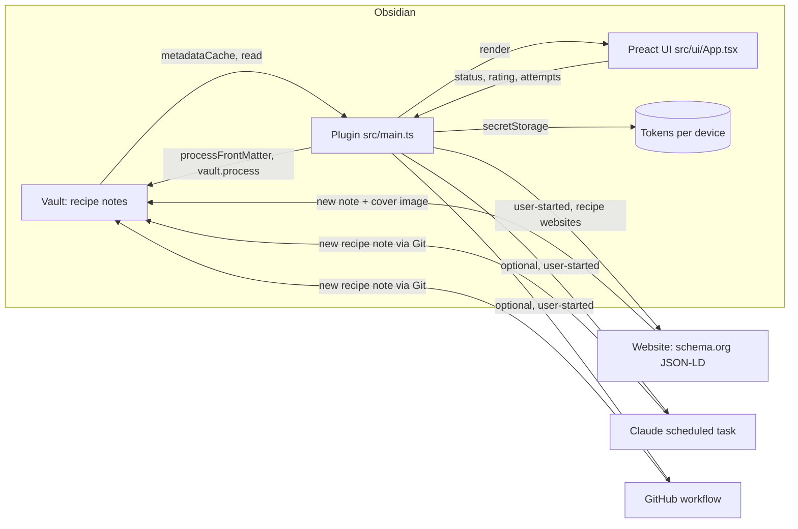

# Architecture

Better Cooking is an Obsidian plugin written in TypeScript. The UI is rendered with Preact inside one Obsidian view; all recipe logic lives in pure functions that run without Obsidian and are tested with Vitest.

## Modules

| File                                                                           | Responsibility                                                                                                 | Depends on Obsidian                  |
| ------------------------------------------------------------------------------ | -------------------------------------------------------------------------------------------------------------- | ------------------------------------ |
| `src/main.ts`                                                                  | Plugin entry, view, settings tab, writes to notes, starts imports                                              | yes                                  |
| `src/settings.ts`                                                              | Settings model, defaults and the settings tab (recipe folder with folder suggestions, processors, tokens)      | yes                                  |
| `src/migrate.ts`                                                               | Maps settings saved with German keys (0.2.1 and earlier) to the current keys                                   | no                                   |
| `src/folder.ts`                                                                | Cleans the recipe folder setting and decides which files belong to it                                          | no                                   |
| `src/extraProperties.ts`                                                       | Extra frontmatter properties from the settings; whether a website is read locally                              | no                                   |
| `src/network.ts`                                                               | Checks that image addresses from imported pages point to public hosts                                          | no                                   |
| `src/view.ts`                                                                  | The Obsidian view: reads the recipe folder, renders the UI, writes status, rating and attempts                 | yes                                  |
| `src/localImport.ts`                                                           | Local website import: loads the page and cover image (`requestUrl`), creates the note                          | yes                                  |
| `src/schemaorg.ts`                                                             | Finds the schema.org Recipe in a page's JSON-LD and turns it into plain fields; strips HTML                    | no                                   |
| `src/recipeNote.ts`                                                            | Builds a recipe note in the documented format from imported data; safe file names; neutralizes page text       | no                                   |
| `src/parse.ts`                                                                 | Reads a recipe note into the data model; inserts an attempt                                                    | no                                   |
| `src/quantities.ts`                                                            | Parses amounts, scales them for other servings, rounds sensibly (g, ml, fractions for spoons)                  | no                                   |
| `src/cooking.ts`                                                               | Durations in steps (timers), ingredients per step, equipment                                                   | no                                   |
| `src/search.ts`                                                                | Search index (MiniSearch: BM25+, prefix, fuzzy), German normalization, compound words, OR fallback             | no                                   |
| `src/source.ts`                                                                | Detects the kind of source (website, Instagram, TikTok, YouTube, Facebook, Pinterest, text) and duplicate keys | no                                   |
| `src/processor.ts`                                                             | Builds requests for the processors, evaluates answers, tracks open import jobs                                 | no                                   |
| `src/development.ts`                                                           | Development builds only: reloads the plugin after `pnpm dev` rebuilt it; not in release builds                 | yes                                  |
| `src/reload.ts`                                                                | Decides when a rebuilt plugin may reload itself                                                                | no                                   |
| `src/types.ts`                                                                 | Data model                                                                                                     | no                                   |
| `src/ui/App.tsx`                                                               | State (open recipe, cooking mode, timers, dialogs), keyboard shortcuts and layout                              | no (runs in the browser preview too) |
| `src/ui/overview.tsx`, `src/ui/sidebar.tsx`                                    | Overview with cards, sidebar with lists and search, view settings                                              | no (runs in the browser preview too) |
| `src/ui/recipePage.tsx`, `src/ui/ingredients.tsx`                              | Recipe page, servings, ingredient list, steps with timers                                                      | no (runs in the browser preview too) |
| `src/ui/cookingMode.tsx`                                                       | Cooking mode with timer bar                                                                                    | no (runs in the browser preview too) |
| `src/ui/jobs.tsx`, `src/ui/attempt.tsx`                                        | Import dialog and import jobs, dialog for an attempt                                                           | no (runs in the browser preview too) |
| `src/ui/shared.tsx`, `src/ui/icons.tsx`, `src/ui/svg.ts`, `src/ui/keyboard.ts` | Shared building blocks, icons, SVG sanitizing, keyboard scope                                                  | no (runs in the browser preview too) |
| `src/plugin.css`                                                               | Layout and the "kitchen" palette; `scripts/build-styles.mjs` adds fonts and writes `styles.css`                | no                                   |

## What the plugin writes

Only inside the recipe folder. In existing recipe notes:

- frontmatter fields `status`, `bewertung`, `zuletzt_gemacht`, `aktualisiert` (via `fileManager.processFrontMatter`),
- the `## Versuche` section, where a new attempt is inserted at the top (via `vault.process`).

New notes only come from an import the user started:

- **Recipe website with schema.org data** (`src/localImport.ts`), unless the setting "Rezeptseiten selbst lesen" is off and a processor is set up: one new note `<title>.md` in the recipe folder (with " 2", " 3" … if the name exists) and its cover image `Bilder/<title> Titelbild.<jpg|png|webp|gif|avif>`. Existing files are never overwritten; the folders are created if missing. The note's frontmatter also carries the user's extra properties (setting "Zusätzliche Eigenschaften", `src/extraProperties.ts`).
- **Everything else** (social media, text, websites without recipe data): a processor creates the note (see [import-contract.md](import-contract.md)).

## Preview without Obsidian

`pnpm preview` builds `dev/preview.js` from `dev/preview.tsx`, which renders `App` with the recipes from `tests/fixtures/` (or `REZEPTE_ORDNER=/path pnpm preview`). Open `dev/preview.html`; URL parameters: `theme=dunkel`, `rezept=<name>`, `kochen=1`, `import=1`, `suche=…`, `versuch=1`, `auftrag=1`, `leer=1`.

## Known technical debt

Tracked as issues: German section names, settings without the declarative settings API, German identifiers.
