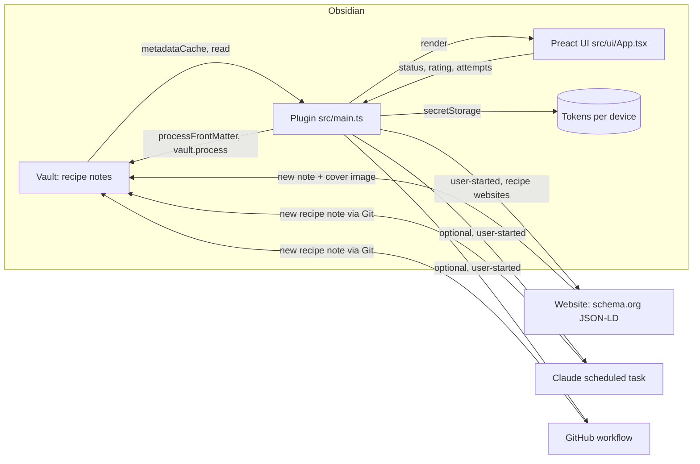

# Architecture

Better Cooking is an Obsidian plugin written in TypeScript. The UI is rendered with Preact inside one Obsidian view; all recipe logic lives in pure functions that run without Obsidian and are tested with Vitest.

## Modules

| File                                                                           | Responsibility                                                                                                                                                                                                                                                                              | Depends on Obsidian                  |
| ------------------------------------------------------------------------------ | ------------------------------------------------------------------------------------------------------------------------------------------------------------------------------------------------------------------------------------------------------------------------------------------- | ------------------------------------ |
| `src/main.ts`                                                                  | Plugin entry, view, settings tab, writes to notes, starts imports                                                                                                                                                                                                                           | yes                                  |
| `src/settings.ts`                                                              | Settings model and defaults                                                                                                                                                                                                                                                                 | no                                   |
| `src/settingsTab.ts`                                                           | Settings tab, declared once for Obsidian's settings search (1.13+) and rendered the same way on older versions                                                                                                                                                                              | yes                                  |
| `src/settingsRows.ts`, `src/settingsAi.ts`                                     | Building blocks of the settings tab (recipe folder, secrets) and the own-AI settings                                                                                                                                                                                                        | yes                                  |
| `src/migrate.ts`                                                               | Maps settings saved with German keys (0.2.1 and earlier) to the current keys                                                                                                                                                                                                                | no                                   |
| `src/servingsWords.ts`                                                         | Generic servings words (Portionen, servings, Personen, people, Stück, pieces) in the language shown; recipe units stay                                                                                                                                                                      | no                                   |
| `src/i18n.ts`, `src/strings/`                                                  | Interface language (English, German by Obsidian's language) and the strings, one file per language                                                                                                                                                                                          | no                                   |
| `src/folder.ts`                                                                | Cleans the recipe folder setting and decides which files belong to it                                                                                                                                                                                                                       | no                                   |
| `src/noteFormat.ts`                                                            | Field names, values and headings of notes in German or English, own field names; reads both                                                                                                                                                                                                 | no                                   |
| `src/extraProperties.ts`                                                       | Extra frontmatter properties from the settings; whether a website is read locally                                                                                                                                                                                                           | no                                   |
| `src/network.ts`                                                               | Checks that image addresses from imported pages point to public hosts                                                                                                                                                                                                                       | no                                   |
| `src/importCheck.ts`                                                           | Finds content in imported notes that other plugins could run (Templater, code, Dataview, HTML, action links, note embeds)                                                                                                                                                                   | no                                   |
| `src/view.ts`                                                                  | The Obsidian view: reads the recipe folder, renders the UI, writes status, rating and attempts                                                                                                                                                                                              | yes                                  |
| `src/localImport.ts`                                                           | Local website import: loads the page and cover image (`requestUrl`), creates the note                                                                                                                                                                                                       | yes                                  |
| `src/ai.ts`                                                                    | Own AI: requests for Anthropic and OpenAI-compatible endpoints, reading and checking the answer                                                                                                                                                                                             | no                                   |
| `src/translate.ts`                                                             | Translations with the own AI: texts of a recipe, checking the answer against the original                                                                                                                                                                                                   | no                                   |
| `src/aiImport.ts`                                                              | Import with the own AI: page or text to the AI, answer to a note                                                                                                                                                                                                                            | yes                                  |
| `src/refetch.ts`                                                               | "Fetch again": merges a fresh reading into a note (what is replaced, what stays), change list, backup text, when it is allowed                                                                                                                                                              | no                                   |
| `src/refetchService.ts`                                                        | "Fetch again" in Obsidian: reads the page, remembers the cover address, writes backup and note                                                                                                                                                                                              | yes                                  |
| `src/ui/refetchModal.tsx`                                                      | The dialog: reads, lists the changes, asks to confirm                                                                                                                                                                                                                                       | no                                   |
| `src/textRecipe.ts`                                                            | Structures pasted recipe text without AI (headings, quantity lines, numbered steps)                                                                                                                                                                                                         | no                                   |
| `src/headings.ts`                                                              | The heading words of pasted texts ("Zutaten", "Method" …) in one place for textRecipe.ts and caption.ts                                                                                                                                                                                     | no                                   |
| `src/caption.ts`                                                               | Prepares social media captions for the text rules (#88): safe rules always (Instagram prefix, hashtag lines, number and bullet emoji), caption rules with `recipeFromText(text, { caption: true })` or for a clear caption (inline headings, one-line captions); recognizes "recipe in bio" | no                                   |
| `src/stepSplit.ts`                                                             | Makes imported instructions fit for cooking mode (#62): one action or waiting time per step, short title, duration; limits                                                                                                                                                                  | no                                   |
| `src/sentences.ts`                                                             | Sentence and enumeration splitting for instructions (abbreviations, decimals, ordinals)                                                                                                                                                                                                     | no                                   |
| `src/stepTitle.ts`                                                             | Step titles from the text's own verb (German, English, du form), waiting clauses and their durations                                                                                                                                                                                        | no                                   |
| `src/schemaorg.ts`                                                             | Finds the schema.org Recipe in a page's JSON-LD and turns it into plain fields; strips HTML                                                                                                                                                                                                 | no                                   |
| `src/microdata.ts`                                                             | schema.org Recipe from microdata (itemscope/itemprop) in the same shape as JSON-LD, with DOMParser                                                                                                                                                                                          | no                                   |
| `src/recipeNote.ts`                                                            | Builds a recipe note in the documented format from imported data; safe file names; neutralizes page text                                                                                                                                                                                    | no                                   |
| `src/parse.ts`                                                                 | Reads a recipe note into the data model; inserts an attempt                                                                                                                                                                                                                                 | no                                   |
| `src/units.ts`                                                                 | Unit tables: known units, singular/plural forms, metric base units                                                                                                                                                                                                                          | no                                   |
| `src/quantities.ts`                                                            | Parses amounts, scales them for other servings, rounds sensibly (g, ml, fractions for spoons)                                                                                                                                                                                               | no                                   |
| `src/bottomInset.ts`                                                           | How far Obsidian bars (status bar on desktop, navigation bar on mobile), the safe area and the keyboard cover the bottom of the view (pure functions)                                                                                                                                       | no                                   |
| `src/insets.ts`                                                                | Measures bars, safe areas and on-screen keyboard in the view's document and sets `--rz-unten` / `--rz-tastatur` / `--rz-links` / `--rz-rechts` (also used by the preview)                                                                                                                   | no                                   |
| `src/madeUndo.ts`                                                              | "Made today" and its undo on the frontmatter: keeps the raw values from before, compare-and-set                                                                                                                                                                                             | no                                   |
| `src/shopping.ts`                                                              | Shopping list: items from ingredients, merging equal items, reading and writing the list note                                                                                                                                                                                               | no                                   |
| `src/shoppingEdit.ts`                                                          | Shopping list page: reads the note into rows, applies the page's edits (tick, remove an item, add an own item, remove checked, remove a recipe)                                                                                                                                             | no                                   |
| `src/hanging.ts`                                                               | Which lines hang below an entry of a note (indented deeper, up to an empty line or the next entry): shopping list items and meal plan entries                                                                                                                                               | no                                   |
| `src/noteSync.ts`                                                              | Which read or write of a list note may still set the view's state                                                                                                                                                                                                                           | no                                   |
| `src/planEdit.ts`                                                              | Meal plan page: reads the plan note into entry rows, applies the page's edits (move to another day, change servings, remove)                                                                                                                                                                | no                                   |
| `src/ingredientKey.ts`, `src/ingredientWords.ts`                               | Ingredient identity: when two names are the same ingredient (docs/shopping-identity.md); word lists and patterns shared with amounts and step matching                                                                                                                                      | no                                   |
| `src/mealPlan.ts`                                                              | Meal plan: reading and adding day headings and entries, the next days, calendar export                                                                                                                                                                                                      | no                                   |
| `src/listNoteResolve.ts`                                                       | Which file a list note uses: a path from the settings, otherwise existing default notes of either language (decided at every access, no stored state), otherwise the default of the note language (#76)                                                                                     | no                                   |
| `src/listNotes.ts`                                                             | Shopping list and meal plan notes in the vault: paths, creating, changing, opening                                                                                                                                                                                                          | yes                                  |
| `src/share.ts`, `src/ui/shareModal.tsx`                                        | Share a recipe: plain text, a print page (escaped HTML in a hidden frame, desktop) and the device's share menu                                                                                                                                                                              | no / yes                             |
| `src/cooking.ts`                                                               | Durations in steps (timers), ingredients per step, equipment                                                                                                                                                                                                                                | no                                   |
| `src/timers.ts`                                                                | Cooking timers as a model: start, pause, continue, +1 minute, cancel, which are due, remaining time, order, reading the stored list (no clock, `now` is passed in)                                                                                                                          | no                                   |
| `src/timerStore.ts`                                                            | The list of timers with one timeout per running timer, saving on every change, reporting the ones that are over (clock, storage and alert are passed in)                                                                                                                                    | no (runs in the browser preview too) |
| `src/timerService.ts`                                                          | Timers of the plugin: local storage, notice with Stop, system notification (desktop), gong, status bar, screen lock, check when the window is visible again                                                                                                                                 | yes                                  |
| `src/timerSound.ts`, `src/wakeLock.ts`                                         | The gong (WebAudio, repeated, at most 2 minutes) and the volume steps; the screen lock with several reasons that is requested again when the page is visible again                                                                                                                          | no                                   |
| `src/settingsTimer.ts`                                                         | Settings group "Cooking mode": timer volume and a test gong                                                                                                                                                                                                                                 | yes                                  |
| `src/ui/timerBar.tsx`, `src/ui/useTimers.ts`                                   | Timer bar of the view and the hook that follows the store (one tick per second only while a timer runs and the view is visible)                                                                                                                                                             | no (runs in the browser preview too) |
| `src/search.ts`                                                                | Search index (MiniSearch: BM25+, prefix, fuzzy), German normalization, compound words, OR fallback                                                                                                                                                                                          | no                                   |
| `src/source.ts`                                                                | Detects the kind of source (website, Instagram, TikTok, YouTube, Facebook, Pinterest, text) and duplicate keys                                                                                                                                                                              | no                                   |
| `src/processor.ts`                                                             | Builds requests for the processors, evaluates answers, tracks open import jobs                                                                                                                                                                                                              | no                                   |
| `src/importSync.ts`                                                            | When a waiting import triggers a sync (pace, limits, allowed command, device)                                                                                                                                                                                                               | no                                   |
| `src/importSyncService.ts`                                                     | Timer, foreground event and the pull command of Obsidian Git while an import waits; device ID                                                                                                                                                                                               | yes                                  |
| `src/development.ts`                                                           | Development builds only: reloads the plugin after `pnpm dev` rebuilt it; not in release builds                                                                                                                                                                                              | yes                                  |
| `src/reload.ts`                                                                | Decides when a rebuilt plugin may reload itself                                                                                                                                                                                                                                             | no                                   |
| `src/types.ts`                                                                 | Data model                                                                                                                                                                                                                                                                                  | no                                   |
| `src/ui/App.tsx`                                                               | State (open recipe, cooking mode, timers, dialogs), keyboard shortcuts and layout                                                                                                                                                                                                           | no (runs in the browser preview too) |
| `src/ui/lists.ts`                                                              | Lists of the overview: counts, categories, filter and sort, import cards per list, list name                                                                                                                                                                                                | no                                   |
| `src/ui/overview.tsx`, `src/ui/sidebar.tsx`                                    | Overview with cards, sidebar with lists and search, view settings                                                                                                                                                                                                                           | no (runs in the browser preview too) |
| `src/ui/recipePage.tsx`, `src/ui/ingredients.tsx`                              | Recipe page, servings, ingredient list, steps with timers                                                                                                                                                                                                                                   | no (runs in the browser preview too) |
| `src/ui/cookingMode.tsx`                                                       | Cooking mode (the timer bar is `src/ui/timerBar.tsx`)                                                                                                                                                                                                                                       | no (runs in the browser preview too) |
| `src/tapZones.ts`                                                              | Cooking mode taps: is a press a tap and where to, one step function for keys and taps                                                                                                                                                                                                       | no                                   |
| `src/ui/useTapZones.ts`, `src/ui/tapZoneOverlay.tsx`                           | Cooking mode: tap on the sides of the step area, decided on `pointerup` (touch and pen, not the mouse; no dead edge strip; small controls keep their own tap), the click after a turn is swallowed, pulse and one-time hint. No swipe gestures: they open Obsidian's sidebars               | no (runs in the browser preview too) |
| `src/ui/madeButton.tsx`                                                        | "Made today" button with the date of the last time and a short window for Undo                                                                                                                                                                                                              | no (runs in the browser preview too) |
| `src/ui/jobs.tsx`, `src/ui/attempt.tsx`                                        | Import dialog and import jobs, dialog for an attempt                                                                                                                                                                                                                                        | no (runs in the browser preview too) |
| `src/ui/shared.tsx`, `src/ui/icons.tsx`, `src/ui/svg.ts`, `src/ui/keyboard.ts` | Shared building blocks, icons, SVG sanitizing, keyboard scope                                                                                                                                                                                                                               | no (runs in the browser preview too) |
| `src/plugin.css`                                                               | Layout, the "kitchen" palette (Style Settings block at the top), the "obsidian" palette; `scripts/build-styles.mjs` adds fonts                                                                                                                                                              | no                                   |

## What the plugin writes

Only inside the recipe folder. In existing recipe notes:

- frontmatter fields `status`, `rating`, `lastMade`, `updated` (via `fileManager.processFrontMatter`), under the name the note already uses (German, English or own name, `src/noteFormat.ts`), otherwise under the name of the setting "Language of new notes",
- the `## Versuche` / `## Attempts` section, where a new attempt is inserted at the top (via `vault.process`); if it is missing, it is created in the note format's language.

The shopping list note (setting "Shopping list", at the top of the vault unless the setting names a path; see "List note files" below): created when the user adds the first recipe; afterwards only its checkbox lines are changed or appended (`src/shopping.ts`, via `vault.process`). With the setting "Stores", new items go into `## <Store>` sections (created at the end, with an empty line before); an open line above the first section that is only counted up moves into the section of a store that fits by now, unless indented lines hang below it, and a line the user put in a section stays there. The shopping list page (`src/ui/shoppingPage.tsx`) changes the same lines through `src/shoppingEdit.ts`, all via `vault.process`. It ticks or unticks a checkbox line, removes a line together with the note lines hanging below it (lines indented deeper than the item, up to the next checkbox line), removes all checked lines (with their hanging lines), removes all lines only for one recipe (a line shared with other recipes loses only that recipe's name and keeps its amount), and adds a line the user typed (merged and placed like an ingredient; a typed " · " is written as " - ", so it never becomes a recipe). A line is found by its exact text and its number among identical lines, never by line number; a click on a row that moved in the meantime can hit the identical line that took its number (accepted); an edit whose line is gone changes nothing, and an edit that changes nothing leaves the text untouched, line endings included. Only adding an own item creates the note if it does not exist. It is never read as a recipe. The same holds for the meal plan note (setting "Meal plan", see "List note files" below): day headings and entry lines are added (`src/mealPlan.ts`). The meal plan page (`src/ui/planPage.tsx`) changes the plan note through `src/planEdit.ts`, all via `vault.process`: it moves an entry line to another day (a new day heading is created in date order with the plugin's format, and the entry goes below the last line of the day if the day exists), changes the amount in the entry's servings text (only the number, a range becomes one number; an entry without servings gets " · n"), removes an entry, and puts a removed entry back (the "Undo" of a few seconds after removing). An entry is its line plus the lines hanging below it (indented deeper, up to an empty line or the next entry line, `src/hanging.ts`); they move and go with it. A day heading that the plugin wrote (`## <date> · <weekday>`) is removed when its day is left without any content; a heading with text of the user's, or a day with other text below the entries, stays. An entry is found by its day, its exact text and its number among the identical lines of that day (in all sections of that day); an edit whose entry is gone changes nothing, and an edit that changes nothing leaves the text untouched, line endings included. the command "Export meal plan as calendar file" writes `<plan name>.ics` next to it.

### List note files (#76)

Nothing is stored to decide which file a list note uses: it is worked out again at every access (`resolveListNote`, `src/listNoteResolve.ts`; `choice` in `src/listNotes.ts`), so a change of the interface or note language never switches the file and a note that shows up later (sync, created by hand) counts at once. A path the user set in the settings always wins (empty: automatic). Otherwise the notes at the top of the vault with a default name of either language (`Einkaufsliste.md`, `Shopping list.md`, `Wochenplan.md`, `Meal plan.md`, any letter case) compete: the only one; the one with entries; none with entries: the one of the note language. Only when two notes compete are they read (`settle`, with `cachedRead`, counted again only after a note changed) and their entries counted (`countListEntries`); until counted the note of the note language is used, never "0 entries". Without any note the default of the note language is created at the first write and nothing is stored. If two notes have entries, the one with more entries (the newer one on a tie) is used, and that provisional choice is kept in memory for as long as the conflict lasts (the page's own changes and their undo stay in the same file). The page shows a notice with both names and a button each; the choice is stored as the path. Nothing is merged or deleted. A stored path follows its note when the user renames it; so does the automatically used file, which then becomes the user's choice. Deleting a note leaves a stored path: the note is created there again at the next write. The settings show the stored path (empty: automatic) and "In use: <file>". Only the top level of the vault is searched without regard to letter case; a path with a folder must match exactly.

"Fetch again" on a recipe page (`src/refetch.ts`, `src/refetchService.ts`, `src/ui/refetchModal.tsx`, issue #63) is the one place where the plugin rewrites imported content, and only after the user confirmed a dialog that lists what changes (sections, number of ingredients and steps, old to new). It is offered for imported notes (with an `import` or `job` field) whose `source` is a recipe page, never for translations. It reads the page in the plugin; if the page has no recipe data, the dialog offers a button "Read with my AI" and calls the AI only when it is pressed (the page text then goes to the AI provider). In the existing note it:

- merges the header line by line: a real new title (never the placeholder "Rezept"), a new description, the cover embed and the yield and time line (written from the merged frontmatter) replace the old lines; the source line and lines the user added stay,
- replaces `## Zutaten`, `## Schritte` and `## Tipps` (only when the source gives them; only the first section of each name) and the frontmatter fields `yield`, `timeActive`, `timeTotal` and `image`; `category` and `author` only when the note has them empty and never into a field that has an own name (`category: tags` stays the user's); `import` and `import_error` only when the note has them; `updated`,
- keeps everything else as it was, including line endings: `status`, `rating`, `lastMade`, `created`, `source`, extra properties, `## Versuche`, `## Notizen`, `## Bilder`, `## Ablauf` and every section of its own,
- copies the old note into the subfolder `Vorversionen/` of the recipe folder (`<name> (Vorversion YYYY-MM-DD).md`, a number is added if it exists) directly before it writes, from the note as it is then, and aborts if the note changed in between (the dialog then reads the page again). The copy is the one documented exception to "unchanged": the job ID is removed and a field `vorversion` / `previous_version` (link to the recipe) is added. The subfolder is not read as recipes, like `Bilder/`. The plugin never deletes old versions, the user does; queries in Dataview or Bases should leave out the subfolder or notes with that field,
- loads a new cover image only when the page's image address differs from the one remembered for the note (`coverUrls` in `data.json`, set at import and at each update, moved on rename and removed on delete or when the note is gone at start; with no remembered address only a note without an image gets one). The old file stays; if writing fails, the files this run created (new image, backup) are removed again.

Claude and the GitHub action are not used for this: their contract (import-contract.md) creates new notes and, for a known source, only sets the job ID, so the plugin offers "Fetch again" for pages it reads itself (and the own AI for pages without recipe data), and the dialog says so.

New notes only come from an import the user started:

- **Recipe website with schema.org data** (`src/localImport.ts`), unless the setting "Rezeptseiten selbst lesen" is off and a processor is active (not with "None"): one new note `<title>.md` in the recipe folder (with " 2", " 3" … if the name exists) and its cover image `Bilder/<title> Titelbild.<jpg|png|webp|gif|avif>`. Existing files are never overwritten; the folders are created if missing. Field names, values and headings follow the setting "Language of new notes" and "Own field names". The note's frontmatter also carries the user's extra properties (setting "Zusätzliche Eigenschaften", `src/extraProperties.ts`).
- **Pasted text without any processor, or with the processor "None (without AI)"** (`src/textRecipe.ts`): one new note built by offline rules, same safety as the website import.
- **Pasted text and websites without recipe data, with the own AI** (`src/aiImport.ts`, processor "Own AI" or "Automatic" with nothing else set up): the same one new note and cover image (the page's preview image) as above, built from the AI's checked answer.
- **Everything else** (social media; text and websites when Claude or GitHub is the processor): a processor creates the note (see [import-contract.md](import-contract.md)).

**Sync while a job waits (#82).** A job of the processor Claude or GitHub arrives through Git, and on a phone Obsidian Git pulls only at its own interval. With the setting "Sync during an import" (on by default; shown once Claude or GitHub is set up or jobs exist) the plugin runs the pull command of Obsidian Git (`obsidian-git:pull`) while a job waits. Only commands from the fixed list `SYNC_COMMANDS` in `src/importSync.ts` are ever run, and only if Obsidian Git is installed; without it nothing happens and there is no button. The rules are `syncDecision` (pure, tested): automatic syncs only for jobs that **this device** started (a device ID in Obsidian's local storage, not synchronised, is stored as `device` on the job; jobs without it count as started elsewhere), only while the job is open, not failed and younger than `WAIT_MIN` (`jobTimedOut`), and only until its note has arrived. The checks run cheap first (setting on, command present, `navigator.onLine`, an own open job, lock) and only then the arrival check, so there is no scan without need: it reads the recipe files like the view (`isRecipeFile`, no list notes) from the metadata cache and decides with `checkJobs` (job ID, or same source changed after the job), so it works without an open view; closing the job stays with `reconcileJobs`. What the lock and counters do after a run is the pure `afterRun`: they change only if the command really ran, and the button counts no job. The setting is stored in `data.json` and so applies to all devices that share it. Pace by the age of the job: nothing in the first 90 s, then every 30 s until 6 min, then every 60 s until the time limit; at most `AUTO_MAX` (23, derived from the pace up to `WAIT_MIN`) automatic syncs per job (counted in memory); never two syncs less than 25 s apart. Returning to the foreground (`visibilitychange` of the main document) syncs from a job age of 60 s with the same lock. The card of a running job shows the button "Sync now" (once, on the first running job; for every open job, also of another device; off for 5 s after a tap) and from 3 minutes the hint "Shows up after the next sync". Obsidian's command list is not public API: `commandApi` in `src/importSyncService.ts` reads it through a narrow cast and treats "not there" as "no command"; a failing command is ignored and does not start the lock. Obsidian Git's own notices can be hidden in its settings.

## Cooking timers (#58)

The timers belong to the plugin, not to the view: `TimerService` (`src/timerService.ts`) is created with the plugin and keeps running when the view is closed. The App follows `TimerService.store` (`src/timerStore.ts`) through `useTimers`.

- **Storage.** The list is saved in Obsidian's local storage (`app.saveLocalStorage`, key `better-cooking-timers`): per device, not synchronised, not in `data.json`, and it survives closing the view and a restart. An entry holds the id, the step title, the note path, the end as wall clock time and, while paused, the rest; an entry that has been over for more than 12 hours is dropped when it is read. **The timers write nothing into the vault.** The only things in `data.json` are the setting "Timer volume" and the flag for the one-time phone hint.
- **Alert.** One `setTimeout` per running timer, no interval. When the window is visible again (`visibilitychange`) and when the workspace is ready, all timers are checked against the clock and what ended meanwhile is reported at once. A timer that is over stays until the user taps Stop (notice, status bar entry or timer bar); +1 minute starts it again.
- **What an alert does.** A notice without timeout and with a Stop button; a gong every 4 seconds, at most 2 minutes (WebAudio, no file; the audio context is created or woken in the tap that starts a timer); vibration where the device has it; on the desktop a system notification (`Notification`, `requireInteraction`) if the user allowed it, asked when the first timer is started; a click on it opens the recipe. The status bar entry (desktop) shows the next timer.
- **Screen lock.** `WakeLock` holds the lock while the cooking mode is open or a timer runs, and requests it again when the page is visible again (the browser releases it when the page is hidden).
- **Limits.** Plugins cannot send system notifications on a phone, and on a phone neither JavaScript timers nor sound run with the screen locked or in the background. So on a phone the timer rings only while Obsidian is open; the plugin says so once and in the settings. No push service, no calendar file, no tricks with silent audio.

## Languages (#77)

Two settings. "Language" (`language`: auto, de, en) is the interface language: `applyLanguage` in `src/main.ts` at load and when it changes; the app is drawn again with the language as a dependency of the texts it builds (no remount: timers, the open recipe, search and dialogs stay) and the settings tab is drawn again, command names and the ribbon tooltip are set at load only. "Language of new notes" (`noteFormat`: ui, de, en) is what the plugin writes: field names, values, headings, weekdays in plan headings, the generic servings word in plan entries and the decimal separator of shopping list amounts (`plugin.noteLang()`, passed as a required `lang` to every function that writes into a note). A new installation takes the concrete language it starts in, in memory at load, and stores it with its first real save (nothing is written at load); earlier versions' stored de/en stay (migration in `src/migrate.ts`); "ui" (follows the interface, may differ per device) only on an explicit choice.

Display always follows the interface language: `servingsText`, `formatQuantity`, `scaleLine`, `scaledResult`, sharing and the shopping page's amounts (`src/quantities.ts`, `src/servingsWords.ts`). Generic servings words (Portion(en), Person(en), serving(s), people, Stück, pieces) are translated; units of a recipe ("Zopf") and words before an amount ("Ergibt ca.") stay as written. Numbers: `1,5` and `1.5` are 1.5 and are shown with the separator of the interface language. A number with exactly three digits after the separator and no leading zero ("1.000", "1,500"; "0,125" is always a decimal) is ambiguous and not rewritten for grams, millilitres and no unit, but shown as a decimal ("1,500 kg" → "1.5 kg" in English) where its unit makes it one; `readNumber` reads it as a thousands group for grams, millilitres and no unit ("1.000 g" is 1000) and as a decimal for any other unit ("1,500 kg" is 1.5), in both languages.

## Preview without Obsidian

`pnpm preview` builds `dev/preview.js` from `dev/preview.tsx`, which renders `App` with the recipes from `tests/fixtures/` (or `REZEPTE_ORDNER=/path pnpm preview`). Open `dev/preview.html`; URL parameters: `lang=en` (default German; English uses the example recipes in `tests/fixtures/en/`), `notizen=de|en` (language of the example notes, default like `lang`; `lang=en&notizen=de` is an English interface over German notes; `setPreviewLanguage("en")` in the console switches the language at run time), `theme=dunkel`, `palette=obsidian` (colors of the imitated Obsidian theme, light or dark with `theme`), `rezept=<name>`, `kochen=1`, `import=1`, `suche=…`, `versuch=1`, `auftrag=1`, `leer=1`, `einkauf=1` (shopping list page with an example list from `tests/fixtures/lists/`, `einkauf=leer` for an empty one), `plan=1` (meal plan page with an example plan from `tests/fixtures/lists/`, days relative to today; `plan=leer` for an empty one), `ansicht=1` (lists sheet), `ordnerfehlt=1` (with `leer=1`: the recipe folder does not exist).

`mobil=1` imitates Obsidian mobile (`dev/mobil-nachbau.css`): a header on top (48 px plus a 47 px notch), a floating navigation bar over the bottom of the view (64 px, as Obsidian draws it) and simulated safe areas (`sicher=47,34,0,0` sets top, bottom, left, right; landscape example `sicher=0,21,47,47`). `statusleiste=1` adds the desktop status bar. With `tastatur=1` an on-screen keyboard (290 px) appears while a text field has focus. The preview measures with the same code as the plugin (`src/insets.ts`, `src/bottomInset.ts`), so buttons that overlap the bars show up there. The sizes are assumptions; check on a device.

## Known technical debt

Tracked as issues: German section names, settings without the declarative settings API, German identifiers.
