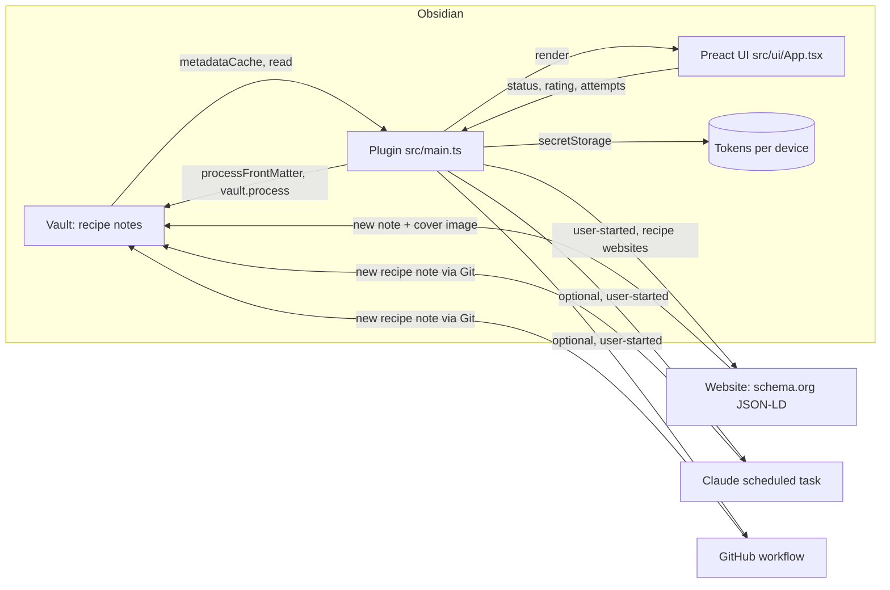

# Architecture

Better Cooking is an Obsidian plugin written in TypeScript. The UI is rendered with Preact inside one Obsidian view; all recipe logic lives in pure functions that run without Obsidian and are tested with Vitest.

## Modules

| File                                                                            | Responsibility                                                                                                                                                            | Depends on Obsidian                  |
| ------------------------------------------------------------------------------- | ------------------------------------------------------------------------------------------------------------------------------------------------------------------------- | ------------------------------------ |
| ------------------------------------------------------------------------------  | ------------------------------------------------------------------------------------------------------------------------------------------------------------------------- | ------------------------------------ |
| `src/main.ts`                                                                   | Plugin entry, view, settings tab, writes to notes, starts imports                                                                                                         | yes                                  |
| `src/settings.ts`                                                               | Settings model and defaults                                                                                                                                               | no                                   |
| `src/settingsTab.ts`                                                            | Settings tab, declared once for Obsidian's settings search (1.13+) and rendered the same way on older versions                                                            | yes                                  |
| `src/settingsRows.ts`, `src/settingsAi.ts`                                      | Building blocks of the settings tab (recipe folder, secrets) and the own-AI settings                                                                                      | yes                                  |
| `src/migrate.ts`                                                                | Maps settings saved with German keys (0.2.1 and earlier) to the current keys                                                                                              | no                                   |
| `src/i18n.ts`, `src/strings/`                                                   | Interface language (English, German by Obsidian's language) and the strings, one file per language                                                                        | no                                   |
| `src/folder.ts`                                                                 | Cleans the recipe folder setting and decides which files belong to it                                                                                                     | no                                   |
| `src/noteFormat.ts`                                                             | Field names, values and headings of notes in German or English, own field names; reads both                                                                               | no                                   |
| `src/extraProperties.ts`                                                        | Extra frontmatter properties from the settings; whether a website is read locally                                                                                         | no                                   |
| `src/network.ts`                                                                | Checks that image addresses from imported pages point to public hosts                                                                                                     | no                                   |
| `src/importCheck.ts`                                                            | Finds content in imported notes that other plugins could run (Templater, code, Dataview, HTML, action links, note embeds)                                                 | no                                   |
| `src/view.ts`                                                                   | The Obsidian view: reads the recipe folder, renders the UI, writes status, rating and attempts                                                                            | yes                                  |
| `src/localImport.ts`                                                            | Local website import: loads the page and cover image (`requestUrl`), creates the note                                                                                     | yes                                  |
| `src/ai.ts`                                                                     | Own AI: requests for Anthropic and OpenAI-compatible endpoints, reading and checking the answer                                                                           | no                                   |
| `src/translate.ts`                                                              | Translations with the own AI: texts of a recipe, checking the answer against the original                                                                                 | no                                   |
| `src/aiImport.ts`                                                               | Import with the own AI: page or text to the AI, answer to a note                                                                                                          | yes                                  |
| `src/refetch.ts`                                                                | "Fetch again": merges a fresh reading into a note (what is replaced, what stays), change list, backup text, when it is allowed                                            | no                                   |
| `src/refetchService.ts`                                                         | "Fetch again" in Obsidian: reads the page, remembers the cover address, writes backup and note                                                                            | yes                                  |
| `src/ui/refetchModal.tsx`                                                       | The dialog: reads, lists the changes, asks to confirm                                                                                                                     | no                                   |
| `src/textRecipe.ts`                                                             | Structures pasted recipe text without AI (headings, quantity lines, numbered steps)                                                                                       | no                                   |
| `src/stepSplit.ts`                                                              | Makes imported instructions fit for cooking mode (#62): one action or waiting time per step, short title, duration; limits                                                | no                                   |
| `src/sentences.ts`                                                              | Sentence and enumeration splitting for instructions (abbreviations, decimals, ordinals)                                                                                   | no                                   |
| `src/stepTitle.ts`                                                              | Step titles from the text's own verb (German, English, du form), waiting clauses and their durations                                                                      | no                                   |
| `src/schemaorg.ts`                                                              | Finds the schema.org Recipe in a page's JSON-LD and turns it into plain fields; strips HTML                                                                               | no                                   |
| `src/microdata.ts`                                                              | schema.org Recipe from microdata (itemscope/itemprop) in the same shape as JSON-LD, with DOMParser                                                                        | no                                   |
| `src/recipeNote.ts`                                                             | Builds a recipe note in the documented format from imported data; safe file names; neutralizes page text                                                                  | no                                   |
| `src/parse.ts`                                                                  | Reads a recipe note into the data model; inserts an attempt                                                                                                               | no                                   |
| `src/units.ts`                                                                  | Unit tables: known units, singular/plural forms, metric base units                                                                                                        | no                                   |
| `src/quantities.ts`                                                             | Parses amounts, scales them for other servings, rounds sensibly (g, ml, fractions for spoons)                                                                             | no                                   |
| `src/bottomInset.ts`                                                            | How far Obsidian bars (status bar on desktop, navigation bar on mobile), the safe area and the keyboard cover the bottom of the view (pure functions)                     | no                                   |
| `src/insets.ts`                                                                 | Measures bars, safe areas and on-screen keyboard in the view's document and sets `--rz-unten` / `--rz-tastatur` / `--rz-links` / `--rz-rechts` (also used by the preview) | no                                   |
| `src/madeUndo.ts`                                                               | "Made today" and its undo on the frontmatter: keeps the raw values from before, compare-and-set                                                                           | no                                   |
| `src/shopping.ts`                                                               | Shopping list: items from ingredients, merging equal items, reading and writing the list note                                                                             | no                                   |
| `src/mealPlan.ts`                                                               | Meal plan: reading and adding day headings and entries, the next days, calendar export                                                                                    | no                                   |
| `src/listNotes.ts`                                                              | Shopping list and meal plan notes in the vault: paths, creating, changing, opening                                                                                        | yes                                  |
| `src/share.ts`, `src/ui/shareModal.tsx`                                         | Share a recipe: plain text, a print page (escaped HTML in a hidden frame, desktop) and the device's share menu                                                            | no / yes                             |
| `src/cooking.ts`                                                                | Durations in steps (timers), ingredients per step, equipment                                                                                                              | no                                   |
| `src/search.ts`                                                                 | Search index (MiniSearch: BM25+, prefix, fuzzy), German normalization, compound words, OR fallback                                                                        | no                                   |
| `src/source.ts`                                                                 | Detects the kind of source (website, Instagram, TikTok, YouTube, Facebook, Pinterest, text) and duplicate keys                                                            | no                                   |
| `src/processor.ts`                                                              | Builds requests for the processors, evaluates answers, tracks open import jobs                                                                                            | no                                   |
| `src/development.ts`                                                            | Development builds only: reloads the plugin after `pnpm dev` rebuilt it; not in release builds                                                                            | yes                                  |
| `src/reload.ts`                                                                 | Decides when a rebuilt plugin may reload itself                                                                                                                           | no                                   |
| `src/types.ts`                                                                  | Data model                                                                                                                                                                | no                                   |
| `src/ui/App.tsx`                                                                | State (open recipe, cooking mode, timers, dialogs), keyboard shortcuts and layout                                                                                         | no (runs in the browser preview too) |
| `src/ui/lists.ts`                                                               | Lists of the overview: counts, categories, filter and sort, import cards per list, list name                                                                              | no                                   |
| `src/ui/overview.tsx`, `src/ui/sidebar.tsx`                                     | Overview with cards, sidebar with lists and search, view settings                                                                                                         | no (runs in the browser preview too) |
| `src/ui/recipePage.tsx`, `src/ui/ingredients.tsx`                               | Recipe page, servings, ingredient list, steps with timers                                                                                                                 | no (runs in the browser preview too) |
| `src/ui/cookingMode.tsx`                                                        | Cooking mode with timer bar                                                                                                                                               | no (runs in the browser preview too) |
| `src/tapZones.ts`                                                               | Cooking mode gestures: is a press a tap and where to, swipe direction, one step function for keys, swipes and taps                                                        | no                                   |
| `src/ui/useTapZones.ts`, `src/ui/useSwipeSteps.ts`, `src/ui/tapZoneOverlay.tsx` | Cooking mode: tap on the sides and swipe in the step area (touch and pen, not the mouse), pulse and one-time hint                                                         | no (runs in the browser preview too) |
| `src/ui/madeButton.tsx`                                                         | "Made today" button with the date of the last time and a short window for Undo                                                                                            | no (runs in the browser preview too) |
| `src/ui/jobs.tsx`, `src/ui/attempt.tsx`                                         | Import dialog and import jobs, dialog for an attempt                                                                                                                      | no (runs in the browser preview too) |
| `src/ui/shared.tsx`, `src/ui/icons.tsx`, `src/ui/svg.ts`, `src/ui/keyboard.ts`  | Shared building blocks, icons, SVG sanitizing, keyboard scope                                                                                                             | no (runs in the browser preview too) |
| `src/plugin.css`                                                                | Layout, the "kitchen" palette (Style Settings block at the top), the "obsidian" palette; `scripts/build-styles.mjs` adds fonts                                            | no                                   |

## What the plugin writes

Only inside the recipe folder. In existing recipe notes:

- frontmatter fields `status`, `rating`, `lastMade`, `updated` (via `fileManager.processFrontMatter`), under the name the note already uses (German, English or own name, `src/noteFormat.ts`), otherwise under the name of the note format setting,
- the `## Versuche` / `## Attempts` section, where a new attempt is inserted at the top (via `vault.process`); if it is missing, it is created in the note format's language.

The shopping list note (setting "Shopping list", default `Einkaufsliste.md` / `Shopping list.md` by the note format, at the top of the vault): created when the user adds the first recipe; afterwards only its checkbox lines are changed or appended (`src/shopping.ts`, via `vault.process`). With the setting "Stores", new items go into `## <Store>` sections (created at the end, with an empty line before); an open line above the first section that is only counted up moves into the section of a store that fits by now, unless indented lines hang below it, and a line the user put in a section stays there. It is never read as a recipe. The same holds for the meal plan note (setting "Meal plan", default `Wochenplan.md` / `Meal plan.md`): day headings and entry lines are added (`src/mealPlan.ts`); the command "Export meal plan as calendar file" writes `<plan name>.ics` next to it.

"Fetch again" on a recipe page (`src/refetch.ts`, `src/refetchService.ts`, `src/ui/refetchModal.tsx`, issue #63) is the one place where the plugin rewrites imported content, and only after the user confirmed a dialog that lists what changes (sections, number of ingredients and steps, old to new). It is offered for imported notes (with an `import` or `job` field) whose `source` is a recipe page, never for translations. It reads the page in the plugin; if the page has no recipe data, the dialog offers a button "Read with my AI" and calls the AI only when it is pressed (the page text then goes to the AI provider). In the existing note it:

- merges the header line by line: a real new title (never the placeholder "Rezept"), a new description, the cover embed and the yield and time line (written from the merged frontmatter) replace the old lines; the source line and lines the user added stay,
- replaces `## Zutaten`, `## Schritte` and `## Tipps` (only when the source gives them; only the first section of each name) and the frontmatter fields `yield`, `timeActive`, `timeTotal` and `image`; `category` and `author` only when the note has them empty and never into a field that has an own name (`category: tags` stays the user's); `import` and `import_error` only when the note has them; `updated`,
- keeps everything else as it was, including line endings: `status`, `rating`, `lastMade`, `created`, `source`, extra properties, `## Versuche`, `## Notizen`, `## Bilder`, `## Ablauf` and every section of its own,
- copies the old note into the subfolder `Vorversionen/` of the recipe folder (`<name> (Vorversion YYYY-MM-DD).md`, a number is added if it exists) directly before it writes, from the note as it is then, and aborts if the note changed in between (the dialog then reads the page again). The copy is the one documented exception to "unchanged": the job ID is removed and a field `vorversion` / `previous_version` (link to the recipe) is added. The subfolder is not read as recipes, like `Bilder/`. The plugin never deletes old versions, the user does; queries in Dataview or Bases should leave out the subfolder or notes with that field,
- loads a new cover image only when the page's image address differs from the one remembered for the note (`coverUrls` in `data.json`, set at import and at each update, moved on rename and removed on delete or when the note is gone at start; with no remembered address only a note without an image gets one). The old file stays; if writing fails, the files this run created (new image, backup) are removed again.

Claude and the GitHub action are not used for this: their contract (import-contract.md) creates new notes and, for a known source, only sets the job ID, so the plugin offers "Fetch again" for pages it reads itself (and the own AI for pages without recipe data), and the dialog says so.

New notes only come from an import the user started:

- **Recipe website with schema.org data** (`src/localImport.ts`), unless the setting "Rezeptseiten selbst lesen" is off and a processor is active (not with "None"): one new note `<title>.md` in the recipe folder (with " 2", " 3" … if the name exists) and its cover image `Bilder/<title> Titelbild.<jpg|png|webp|gif|avif>`. Existing files are never overwritten; the folders are created if missing. Field names, values and headings follow the setting "Note format" and "Own field names". The note's frontmatter also carries the user's extra properties (setting "Zusätzliche Eigenschaften", `src/extraProperties.ts`).
- **Pasted text without any processor, or with the processor "None (without AI)"** (`src/textRecipe.ts`): one new note built by offline rules, same safety as the website import.
- **Pasted text and websites without recipe data, with the own AI** (`src/aiImport.ts`, processor "Own AI" or "Automatic" with nothing else set up): the same one new note and cover image (the page's preview image) as above, built from the AI's checked answer.
- **Everything else** (social media; text and websites when Claude or GitHub is the processor): a processor creates the note (see [import-contract.md](import-contract.md)).

## Preview without Obsidian

`pnpm preview` builds `dev/preview.js` from `dev/preview.tsx`, which renders `App` with the recipes from `tests/fixtures/` (or `REZEPTE_ORDNER=/path pnpm preview`). Open `dev/preview.html`; URL parameters: `lang=en` (default German; English uses the example recipes in `tests/fixtures/en/`), `theme=dunkel`, `palette=obsidian` (colors of the imitated Obsidian theme, light or dark with `theme`), `rezept=<name>`, `kochen=1`, `import=1`, `suche=…`, `versuch=1`, `auftrag=1`, `leer=1`, `ordnerfehlt=1` (with `leer=1`: the recipe folder does not exist).

`mobil=1` imitates Obsidian mobile (`dev/mobil-nachbau.css`): a header on top (48 px plus a 47 px notch), a floating navigation bar over the bottom of the view (64 px, as Obsidian draws it) and simulated safe areas (`sicher=47,34,0,0` sets top, bottom, left, right; landscape example `sicher=0,21,47,47`). `statusleiste=1` adds the desktop status bar. With `tastatur=1` an on-screen keyboard (290 px) appears while a text field has focus. The preview measures with the same code as the plugin (`src/insets.ts`, `src/bottomInset.ts`), so buttons that overlap the bars show up there. The sizes are assumptions; check on a device.

## Known technical debt

Tracked as issues: German section names, settings without the declarative settings API, German identifiers.
